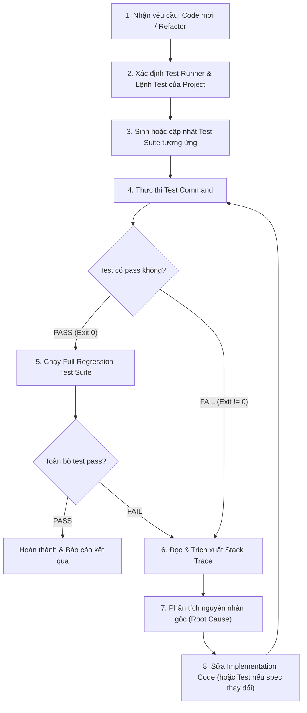

# Autonomous Testing Skill (Aider-Inspired Test-Driven Loop)

Skill này cung cấp quy trình Test-Driven Development (TDD) tự động hóa và vòng lặp tự sửa lỗi (auto-test & self-healing code loop) dựa trên cơ chế `--test-cmd` và `--auto-test` của [Aider](https://github.com/Aider-AI/aider).

Mục tiêu cốt lõi: **Không bao giờ bàn giao code mới hoặc code refactor mà chưa có test suite tương ứng và toàn bộ test của dự án chưa pass 100%.**

---

## 1. Triết lý & Cơ chế hoạt động (Core Loop)

Vòng lặp lấy cảm hứng từ Aider hoạt động theo chu trình khép kín:



### Các nguyên tắc bất di bất dịch:
1. **Zero Suppression**: Không được làm pass test bằng cách xóa assertion, skip test (`it.skip`, `@pytest.mark.skip`), làm rỗng test body, hoặc mock quá mức làm mất giá trị kiểm thử.
2. **Minimal & Targeted Fix**: Khi sửa lỗi dựa trên stack trace, chỉ sửa đúng vùng code gây lỗi; không refactor lan man làm phát sinh lỗi mới.
3. **Preserve Regressions**: Khi viết test mới cho tính năng hoặc bug fix, đảm bảo các test suite cũ trong dự án vẫn pass.
4. **Max Iterations Guard**: Thiết lập giới hạn tối đa 5 vòng lặp sửa lỗi liên tiếp. Nếu sau 5 lần vẫn fail, dừng lại để phân tích lại kiến trúc hoặc hỏi người dùng làm rõ requirement.

---

## 2. Quy trình thực hiện chi tiết (Step-by-Step Runbook)

### Bước 1: Phát hiện Test Runner và Test Command của Dự Án

Trước khi tạo test hay sửa code, agent phải tự động nhận diện hệ thống test của repository:

| Hệ sinh thái | Tập tin nhận diện | Lệnh chạy test đơn lẻ | Lệnh chạy full test |
| :--- | :--- | :--- | :--- |
| **Node.js / TS (Vitest)** | `vitest.config.ts`, `package.json` | `npx vitest run <file>` | `npm test` hoặc `npm run test:all` |
| **Node.js / TS (Jest)** | `jest.config.js`, `package.json` | `npx jest <file>` | `npm test` |
| **Python (pytest)** | `pytest.ini`, `pyproject.toml` | `pytest <file>` | `pytest` |
| **Go** | `go.mod` | `go test -v ./path/to/pkg -run <TestName>` | `go test ./...` |
| **Rust** | `Cargo.toml` | `cargo test <test_name>` | `cargo test` |

> [!TIP]
> Kiểm tra `package.json` (phần `"scripts"`) hoặc cấu hình dự án để dùng chính xác lệnh test dự án đã định nghĩa sẵn (ví dụ: `npm run test`, `npm run test:integration`).

---

### Bước 2: Tự sinh Test Suite tương ứng (Test Suite Generation)

Mỗi khi tạo code mới hoặc refactor một module:
1. **Quy tắc đặt tên và vị trí**:
   - Tuân theo cấu trúc dự án: Co-located (e.g. `src/service.ts` -> `src/service.test.ts`) hoặc thư mục kiểm thử tập trung (e.g. `tests/unit/service.test.ts`).
2. **Nội dung cần bao phủ**:
   - **Happy Path**: Luồng xử lý dữ liệu chuẩn, kết quả đầu ra mong đợi.
   - **Edge Cases**: Giá trị rỗng (`null`, `undefined`, chuỗi rỗng `""`), mảng rỗng, dữ liệu kích thước lớn.
   - **Error Handling**: Kiểm tra exception được ném ra đúng loại và đúng thông điệp khi gặp input không hợp lệ hoặc lỗi mạng/hệ thống.
   - **Boundary Tests**: Các giá trị cận trên/dưới.
3. **Cách viết test**:
   - Rõ ràng theo mô hình **Arrange - Act - Assert** (AAA).
   - Đặt tên test thể hiện rõ hành vi mong đợi: `it('should return cached repository details when cache is valid')`.

---

### Bước 3: Chạy Test & Thu thập Output (Aider Auto-Test Style)

Chạy lệnh test và hứng toàn bộ standard output + standard error:

```bash
# Ví dụ chạy vitest cho một file test cụ thể
npm run test -- tests/search-service.test.ts
```

- Kiểm tra Exit Code của tiến trình:
  - `Exit Code == 0`: Test pass thành công. Chuyển sang Bước 5.
  - `Exit Code != 0`: Test fail. Chuyển sang Bước 4 để đọc stack trace.

---

### Bước 4: Đọc Stack Trace & Phân tích Nguyên nhân Lỗi

Khi test fail, agent phải trích xuất và phân tích 4 thông tin cốt lõi từ output:

1. **Test Failure Name**: Tên test case bị fail.
2. **Error Type & Message**: Ví dụ `AssertionError: expected 'active' to equal 'archived'` hoặc `TypeError: Cannot read property 'map' of undefined`.
3. **Expected vs Actual Diff**:
   ```text
   - Expected  - 1
   + Received  + 1
   - status: "success"
   + status: "failed"
   ```
4. **Stack Trace Location**: File và dòng cụ thể phát sinh lỗi (ví dụ: `at SearchService.filterByStars (src/services/search.ts:42:15)`).

> [!IMPORTANT]
> **Đánh giá nguồn gốc lỗi (Diagnosis)**:
> - Nếu lỗi do implementation logic sai hoặc chưa xử lý trường hợp biên: **Sửa implementation code**.
> - Nếu lỗi do test mock sai context hoặc kỳ vọng sai yêu cầu nghiệp vụ: **Cân nhắc điều chỉnh test suite**, nhưng phải đảm bảo không làm giảm tính chặt chẽ của bài test.

---

### Bước 5: Lặp lại quá trình Sửa Code (Self-Healing Loop)

Áp dụng vòng lặp tự sửa code:

1. **Tạo bản sửa lỗi nhỏ nhất (Minimal Targeted Edit)**: Dùng `edit_file` cập nhật đúng hàm/dòng code cần sửa.
2. **Re-run Test Suite**: Chạy lại lệnh test cho file đang sửa.
3. **Đánh giá kết quả**:
   - Nếu còn lỗi khác: Tiếp tục đọc stack trace mới và sửa tiếp.
   - Nếu đã pass: Tiến hành chạy full test suite để đảm bảo không hồi quy (regression).
4. **Kiểm soát vòng lặp**:
   - Theo dõi số lần lặp: `loop_count = 1 .. 5`.
   - Nếu sau 5 lần sửa test vẫn không pass, tạm dừng và tóm tắt:
     - Danh sách các lỗi chưa sửa được.
     - Giả định mâu thuẫn giữa implementation và test requirement.
     - Đề xuất hướng giải quyết để người dùng duyệt.

---

### Bước 6: Chạy Regression Suite & Nghiệm thu (Convergence)

Khi test đơn lẻ đã pass:
1. Chạy toàn bộ test của project:
   ```bash
   npm test
   ```
2. Nếu có integration test hoặc lint check:
   ```bash
   npm run lint
   npm run test:integration # (nếu dự án cấu hình)
   ```
3. Đảm bảo toàn bộ suite hiển thị trạng thái xanh (Pass 100%).

---

## 3. Mẫu Prompt & Cấu trúc phản hồi nội bộ khi tự sửa lỗi

Dưới đây là cấu trúc tư duy (Chain-of-Thought) agent áp dụng trong quá trình tự sửa lỗi theo stack trace:

```markdown
### Test Failure Analysis
- **Failing Test**: `SearchEngine > should filter repositories with zero stars correctly`
- **Location**: `src/main/search.ts:78`
- **Observed Error**: `TypeError: Cannot read properties of undefined (reading 'stargazers_count')`
- **Root Cause**: Hàm không kiểm tra null-safety khi đối tượng repo thiếu thuộc tính `stargazers_count`.

### Planned Fix
- Cập nhật hàm `filterRepositories` tại `src/main/search.ts` sử dụng optional chaining `repo?.stargazers_count ?? 0`.
- Chạy lại test file: `npm run test -- tests/search.test.ts`.
```

---

## 4. Checklist kiểm tra nhanh cho Agent

Trước khi kết thúc bất kỳ lượt xử lý code nào, tự đối chiếu:

- [ ] Đã tạo/cập nhật file test tương ứng cho phần code mới/refactor chưa?
- [ ] Test suite có kiểm tra cả happy path lẫn error/edge cases chưa?
- [ ] Lệnh test của project đã được thực thi và trả về Exit Code 0 chưa?
- [ ] Đã kiểm tra stack trace chi tiết và sửa triệt để nguyên nhân gốc rễ chưa?
- [ ] Full regression test suite của toàn bộ repo có tiếp tục pass 100% không?
