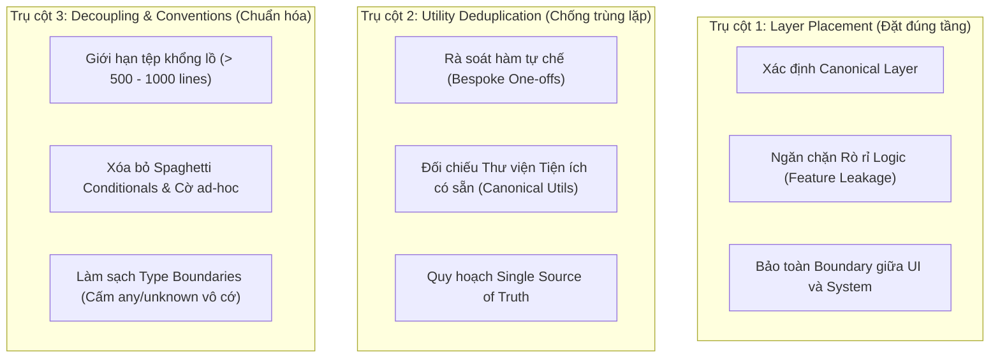

# Thermo-Nuclear Code Quality Audit & Layer Verification

Skill này cung cấp quy chuẩn kiểm định chất lượng mã nguồn cấp độ chuyên sâu ("Thermo-Nuclear Code Quality Review") lấy cảm hứng từ bộ công cụ [Cursor Team Kit](https://github.com/cursor/plugins).

Mục tiêu cốt lõi: **Không dừng lại ở việc code "chạy được". Bắt buộc mã nguồn phải được đặt đúng tầng kiến trúc (canonical layer), triệt tiêu các tiện ích trùng lặp (không phát minh lại bánh xe), xóa bỏ sự phát triển spaghetti của các câu lệnh điều kiện, và thực hiện các bước tái cấu trúc ("Code Judo") giúp codebase thanh thoát, rõ ràng và giảm thiểu tối đa độ phụ thuộc.**

---

## 1. Ba Trụ Cột Đánh Giá Chất Lượng Cốt Lõi (Core Quality Pillars)



---

## 2. Tiêu chí Kiểm định Chi tiết

### Trụ cột 1: Kiểm tra Đúng Tầng Kiến trúc (Canonical Layer Placement)

Mỗi đoạn mã mới hoặc logic hiện tại phải sống đúng tầng chuyên trách:

| Tầng Kiến trúc | Vị trí thư mục | Trách nhiệm được phép | Điều cấm kỵ (Vi phạm Layer) |
| :--- | :--- | :--- | :--- |
| **Presentation (UI)** | `src/renderer/` | Render React components, quản lý UI state cục bộ, binding sự kiện. | ❌ Không gọi Node.js runtime (`fs`, `child_process`).<br/>❌ Không tự tính toán thuật toán ranking/search. |
| **Bridge (Preload)** | `src/preload/` | Định nghĩa API an toàn qua `contextBridge`, invoke IPC Renderer. | ❌ Không chứa logic nghiệp vụ tính toán.<br/>❌ Không expose trực tiếp toàn bộ object Node/Electron. |
| **Controller (IPC)** | `src/main/ipc-handlers.ts`, `handlers/` | Định tuyến IPC channel, validate input schema, bắt và bọc lỗi. | ❌ Không ôm đồm thuật toán nghiệp vụ (> 1000 lines).<br/>❌ Không trực tiếp gọi câu lệnh hệ thống nếu chưa qua service. |
| **Domain Services** | `src/main/search/`, `ranking/` | Thuật toán cốt lõi, chuẩn hóa dữ liệu, tính điểm BM25/semantic. | ❌ Không phụ thuộc vào Electron IPC hay React state.<br/>❌ Phải là pure logic hoặc testable service. |
| **Infrastructure / Store** | `src/main/github/`, `settings/`, `bookmarks/` | Giao tiếp API bên ngoài, lưu trữ tệp mã hóa, cache I/O. | ❌ Không đưa logic định dạng hiển thị UI vào tầng này. |

> [!WARNING]
> **Dấu hiệu vi phạm Layer (Layer Drift)**:
> - Một tính năng cụ thể (feature logic) bị cài cắm rải rác vào các tệp dùng chung (shared path).
> - Tầng Controller thực hiện luôn việc xử lý chuỗi tiếng Việt hoặc tính toán vector thay vì ủy quyền cho Domain Service.

---

### Trụ cột 2: Rà soát Tiện ích Trùng lặp (Utility Deduplication)

Trước khi viết một hàm helper mới, bắt buộc phải kiểm tra xem codebase đã có hàm tương đương hay chưa:

1. **Chuẩn hóa & Xử lý Chuỗi (String Helpers)**:
   - Các hàm xóa dấu tiếng Việt, loại bỏ ký tự đặc biệt, trim, n-gram, Levenshtein distance ➔ Đã có trong [`src/main/search/vietnamese.ts`](file:///Users/andoan/WebstormProjects/github-repo-explorer/src/main/search/vietnamese.ts). Cấm viết lại hàm tương tự trong UI hay Controller.
2. **Xử lý Bất đồng bộ & Đồng thời (Concurrency Helpers)**:
   - Cơ chế chạy tác vụ đồng thời có giới hạn (`boundedAllSettled`), trì hoãn (`sleep`), đo thời gian (`perf`) ➔ Đã có trong [`src/main/utils/concurrency.ts`](file:///Users/andoan/WebstormProjects/github-repo-explorer/src/main/utils/concurrency.ts) và [`src/main/search/perf.ts`](file:///Users/andoan/WebstormProjects/github-repo-explorer/src/main/search/perf.ts).
3. **Bộ nhớ đệm (Caching Utilities)**:
   - Đã có cơ chế LRU cache và TTL cache trong [`src/main/search/cache.ts`](file:///Users/andoan/WebstormProjects/github-repo-explorer/src/main/search/cache.ts) và [`src/main/github/client.ts`](file:///Users/andoan/WebstormProjects/github-repo-explorer/src/main/github/client.ts). Không tự tạo biến `Map` toàn cục thiếu giới hạn dung lượng.

**Câu hỏi tự vấn bắt buộc**:
> *"Hàm này có phải là một tiện ích tự chế (bespoke one-off) cho một bài toán mà codebase đã có giải pháp chính thống (canonical utility) không?"*
> ➔ Nếu có: **Xóa hàm mới và import hàm chính thống.**

---

### Trụ cột 3: Chuẩn hóa Conventions & Tối ưu Module Decoupling

1. **Quy tắc Tệp Khổng lồ (The 1k-Line Guardrail)**:
   - Nghiêm cấm mọi pull request/thay đổi đẩy kích thước tệp vượt qua ngưỡng 1000 dòng mà không có lý do kiến trúc đặc biệt.
   - Khi một tệp vượt ngưỡng (như `ipc-handlers.ts`), yêu cầu tiên quyết là phân rã (decompose) thành các module con trước khi bổ sung tính năng mới.
2. **Chặn Đứng Spaghetti Conditionals**:
   - Nghiêm cấm bổ sung các cờ hiệu (boolean flags), biến `mode?: string`, hoặc các câu lệnh `if` tùy tiện chen ngang vào giữa một luồng nghiệp vụ phức tạp.
   - Thay vì chắp vá điều kiện, áp dụng **Strategy Pattern** hoặc tách luồng riêng biệt.
3. **Làm Sạch Type Boundaries**:
   - Nghiêm cấm dùng `any`, ép kiểu mù quáng (`as unknown as Type`), hoặc các tham số tùy chọn (`optional params`) tràn lan để che giấu sự mơ hồ về mặt dữ liệu.
   - Toàn bộ giao tiếp liên module phải thông qua TypeScript interfaces rõ ràng tại [`src/shared/types.ts`](file:///Users/andoan/WebstormProjects/github-repo-explorer/src/shared/types.ts).
4. **Tư duy "Code Judo" (Tối giản Hóa Cấu trúc)**:
   - Tìm kiếm các giải pháp tái cấu trúc giúp loại bỏ hoàn toàn các tầng trung gian không cần thiết (identity wrappers, pass-through functions).
   - Giải pháp tốt nhất là giải pháp **xóa bớt code** mà vẫn giữ nguyên vẹn hành vi của hệ thống.

---

## 3. Quy trình Kiểm định Thực tế (Step-by-Step Runbook)

Khi kích hoạt skill kiểm định chất lượng:

### Bước 1: Quét Phạm vi & Rà soát Tầng (Scope & Layer Audit)
- Kiểm tra danh sách các file thay đổi hoặc file được chỉ định.
- Đối chiếu đường dẫn file với bảng Layer Placement. Ghi nhận vi phạm nếu có logic nghiệp vụ nằm sai tầng.

### Bước 2: Dò tìm Utility Trùng lặp (Canonical Match)
- Sử dụng tìm kiếm mẫu để đối chiếu các hàm helper mới viết với danh mục `src/shared/`, `src/main/utils/`, `src/main/search/`.
- Lập danh sách các hàm cần gộp hoặc thay thế.

### Bước 3: Đánh giá Ranh giới & Độ Phụ thuộc (Decoupling Check)
- Đếm số dòng của từng file bị ảnh hưởng (`wc -l`).
- Kiểm tra danh sách import: xem có module nào bị phụ thuộc vòng (circular import) hoặc import xuyên tầng bị cấm không (ví dụ renderer import trực tiếp file từ `src/main/`).

### Bước 4: Xuất Báo cáo & Đề xuất Bản vá Tối ưu
- Xuất báo cáo đánh giá theo mẫu bên dưới kèm dẫn chứng file:line và giải pháp khắc phục triệt để.

---

## 4. Mẫu Báo cáo Kiểm định Chất lượng Mã nguồn (Audit Report Template)

```markdown
# 🔬 Thermo-Nuclear Code Quality & Layer Audit Report

### 1. Tổng quan Đánh giá
- **Đối tượng kiểm tra**: [PR / Module / File Path]
- **Mức độ tuân thủ Layer**: [TUÂN THỦ | CẦN ĐIỀU CHỈNH | VI PHẠM NGHIÊM TRỌNG]
- **Số utility trùng lặp phát hiện**: X
- **Tình trạng phân rã module**: [Gọn gàng | Cảnh báo tệp lớn | Spaghetti code]

---

### 2. Chi tiết Phát hiện & Đánh giá Cấu trúc

#### 🚩 Phát hiện 1: Đặt Sai Tầng Kiến Trúc (Layer Drift)
- **Vị trí**: `src/renderer/components/SearchBar.tsx:42`
- **Vấn đề**: Logic chuẩn hóa chuỗi và tách từ dừng tiếng Việt được viết trực tiếp trong React Component.
- **Khắc phục ("Code Judo")**: Chuyển toàn bộ logic sang Domain Service `src/main/search/vietnamese.ts` và gọi qua IPC contract chuẩn.

#### 🚩 Phát hiện 2: Phát minh lại Tiện ích (Duplicate Utility)
- **Vị trí**: `src/main/llm/manager.ts:85`
- **Vấn đề**: Tự viết hàm `delay(ms)` bằng `new Promise(r => setTimeout(r, ms))`.
- **Khắc phục**: Tái sử dụng canonical helper có sẵn: `import { sleep } from '../utils/concurrency'`.

#### 🚩 Phát hiện 3: Tệp Khổng Lồ & Thiếu Decoupling
- **Vị trí**: `src/main/ipc-handlers.ts` (1625 dòng)
- **Vấn đề**: Tệp đã vượt ngưỡng 1k dòng, vi phạm tiêu chuẩn duy trì mã nguồn của Cursor.
- **Khắc phục**: Phân rã theo router domains (`search.ipc.ts`, `clone.ipc.ts`, `settings.ipc.ts`).

---

### 3. Checklist Hành động Tiếp theo
- [ ] Di dời các hàm xử lý dữ liệu về đúng Canonical Layer.
- [ ] Xóa bỏ các hàm tiện ích trùng lặp, chuyển sang dùng shared utilities.
- [ ] Loại bỏ các câu lệnh `any` và chuẩn hóa type contracts.
```
