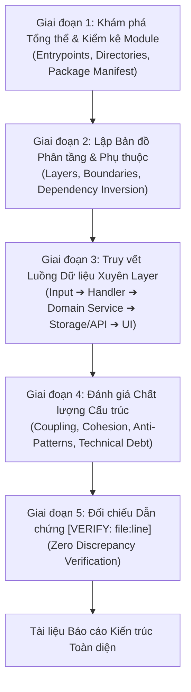
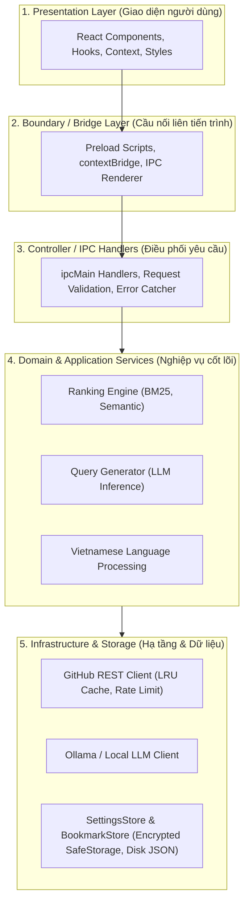

# Codebase Architecture Analysis & Data Flow Mapping Skill

Skill này cung cấp phương pháp luận phân tích tĩnh kiến trúc phần mềm, xác định ranh giới module (boundaries), lập bản đồ phụ thuộc (dependency flow) và truy vết luồng dữ liệu (cross-layer data flow) lấy cảm hứng từ [Ycsyyds/codebase-analysis-skill](https://github.com/Ycsyyds/codebase-analysis-skill).

---

## 1. Nguyên tắc Cốt lõi: Zero Hallucination & Evidence-First

> [!IMPORTANT]
> **Nguyên tắc bất biến**:
> 1. **Không suy diễn, không phỏng đoán**: Mọi nhận định về kiến trúc, pattern, luồng dữ liệu hoặc ranh giới module bắt buộc phải có dẫn chứng mã nguồn thực tế kèm số dòng cụ thể: `[VERIFY: path/to/file:line]`.
> 2. **Code Reading First**: Không bao giờ viết nhận định hoặc vẽ sơ đồ trước khi đọc trực tiếp các tệp nguồn liên quan.
> 3. **Verification Loop**: Mọi sơ đồ Mermaid hoặc bảng tổng kết phải được đối chiếu lại với code để loại bỏ hoàn toàn các giả định sai lệch.

---

## 2. Quy trình Phân tích 5 Giai đoạn (5-Stage Methodology)



---

### Giai đoạn 1: Khám phá Tổng thể & Kiểm kê Module (Global Exploration)

1. **Xác định các điểm khởi đầu (Entrypoints)**:
   - Frontend: `src/renderer/main.tsx`, `index.html`.
   - Backend/Main: `src/main/index.ts`, `src/preload/index.ts`.
   - Cấu hình Build/Tooling: `package.json`, `vite.config.ts`, `tsconfig.json`.
2. **Kiểm kê Module (Module Inventory)**:
   - Lập danh sách từng thư mục trong `src/`, xác định chức năng chính, các public interfaces và các tệp xuất khẩu (exported symbols).

---

### Giai đoạn 2: Lập Bản đồ Phân tầng & Ranh giới Module (Architectural Layers & Boundaries)

Phân loại cấu trúc codebase vào mô hình phân tầng chuẩn:



**Tiêu chí đánh giá ranh giới (Boundaries)**:
- **Clean Separation**: Layer trên chỉ phụ thuộc layer dưới; không có phụ thuộc vòng (circular dependency).
- **Leaky Abstraction**: Kiểm tra xem tầng UI có gọi thẳng Node APIs hay không; tầng IPC có xử lý nghiệp vụ nặng thay cho Domain Service hay không.

---

### Giai đoạn 3: Truy vết Luồng Dữ liệu Xuyên Layer (Cross-Layer Data Flow Tracing)

Truy vết chi tiết từng luồng dữ liệu chính từ lúc bắt đầu cho đến khi kết thúc:

1. **Trigger / Entry**: Sự kiện từ phía người dùng (ví dụ: gõ từ khóa tìm kiếm và nhấn Enter).
2. **IPC Transport**: Dữ liệu đóng gói qua `window.repoExplorer.*` ➔ `ipcRenderer.invoke` ➔ `ipcMain.handle`.
3. **Validation & Normalization**: Dữ liệu đi qua bước lọc đầu vào, chuẩn hóa tiếng Việt, tách Intent.
4. **Processing & Enrichment**: Gọi LLM sinh query hoặc gọi GitHub API tìm repos; tính điểm ranking.
5. **Storage / Caching**: Ghi nhận cache (in-memory hoặc disk); mã hóa token nhạy cảm.
6. **Return / Presentation**: Đóng gói payload trả ngược về Renderer cập nhật state và render DOM.

Mỗi bước trong luồng dữ liệu **bắt buộc dẫn chiếu chính xác file và dòng code**:
```text
[Input] SearchBar.tsx:45 
   ➔ [Preload] preload/index.ts:12 
   ➔ [IPC] ipc-handlers.ts:557 
   ➔ [Normalization] vietnamese.ts:70 
   ➔ [QueryGen] query-gen.ts:63 
   ➔ [Client] github/client.ts:151 
   ➔ [Ranking] ranking/engine.ts:40 
   ➔ [UI Render] ResultCard.tsx:28
```

---

### Giai đoạn 4: Đánh giá Chất lượng Cấu trúc (Structural Quality Evaluation)

Agent thực hiện rà soát và cho điểm dựa trên 5 tiêu chí kiến trúc:

| Tiêu chí | Nội dung kiểm tra | Dẫn chứng kiểm tra trong mã nguồn |
| :--- | :--- | :--- |
| **Cohesion (Độ kết dính)** | Mỗi module chỉ giải quyết một miền bài toán duy nhất (SRP). | Xem xét kích thước file, số lượng hàm và trách nhiệm (e.g., `ipc-handlers.ts` có bị quá tải không). |
| **Coupling (Độ phụ thuộc)** | Giảm thiểu sự gắn kết cứng giữa các module. | Đánh giá việc sử dụng interfaces (e.g., `ILlmClient`), dependency injection. |
| **Isolation (Tính cô lập)** | Cách ly an toàn giữa tiến trình Renderer và Main Process. | Kiểm tra `contextIsolation: true`, `nodeIntegration: false` trong `index.ts`. |
| **Resilience (Khả năng chịu lỗi)** | Xử lý timeout, lỗi mạng, rate-limit, fallback. | Kiểm tra `fetchWithRetry` trong `github/client.ts`, fallback dictionary khi LLM offline. |
| **Scalability (Khả năng mở rộng)** | Dễ dàng bổ sung model mới, search provider mới. | Kiểm tra kiến trúc `llmManager.getClient(cfg)`. |

---

## 3. Mẫu Báo cáo Kiến trúc Chuẩn (Architecture Report Template)

Khi thực thi phân tích kiến trúc, agent tạo báo cáo theo cấu trúc Markdown chuẩn:

```markdown
# 🏛️ Architectural Assessment & Data Flow Mapping Report

## 1. Executive Summary & Module Inventory
- **Mô hình kiến trúc tổng thể**: [Electron Multi-Process Architecture / Clean Layered Architecture]
- **Số lượng Modules chính**: X modules
- **Bảng kiểm kê module và trách nhiệm**:
  | Module | Vị trí thư mục | Trách nhiệm chính | Public Symbols |
  | :--- | :--- | :--- | :--- |
  | Search Engine | `src/main/search` | Sinh query, tiền xử lý ngôn ngữ | `QueryGenerator`, `detectVietnamese` |

## 2. Dependency Flow & Boundary Analysis
[Sơ đồ Mermaid biểu diễn quan hệ giữa các module]

## 3. End-to-End Data Flow Tracing
[Bảng truy vết từng bước của luồng nghiệp vụ với dẫn chứng file:line:column]

## 4. Architectural Findings & Technical Debt
- **Điểm mạnh (Strengths)**:
  - Dẫn chứng 1: `[VERIFY: src/main/github/client.ts:39]` - Triển khai retry backoff cho 429 và 5xx.
- **Rủi ro & Điểm cần tối ưu (Architectural Risks)**:
  - Dẫn chứng 2: `[VERIFY: src/main/ipc-handlers.ts:1]` - Tập tin controller quá lớn (>1500 dòng), vi phạm SRP.

## 5. Đề xuất Tái cấu trúc (Refactoring Roadmap)
- Kế hoạch chia nhỏ controller thành các route modules độc lập.
```

---

## 4. Checklist Kiểm tra Độ Chính xác cho Agent

- [ ] Đã đọc trực tiếp toàn bộ các tệp kiến trúc trước khi viết đánh giá chưa?
- [ ] 100% các nhận định đều có kèm tag `[VERIFY: file:line]` có thể kiểm chứng được?
- [ ] Đã vẽ sơ đồ phân tầng (Mermaid) phản ánh đúng import/export thực tế?
- [ ] Không có giả định nào về pattern nếu không tìm thấy code minh chứng?
