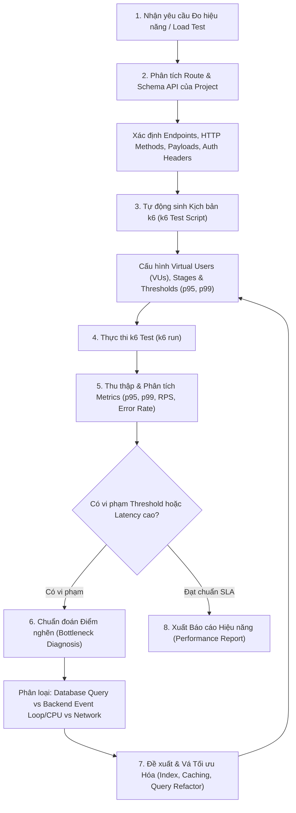

# Performance & Load Testing Skill (Grafana k6 Engine)

Skill này cung cấp quy trình tự động hóa kiểm thử hiệu năng, đo đạc tải trọng (load testing) và chuẩn đoán điểm nghẽn (bottleneck profiling) cho các dịch vụ Backend/API dựa trên nền tảng [Grafana k6](https://github.com/grafana/k6).

Mục tiêu cốt lõi: **Tự động quét và hiểu toàn bộ API routes/schema của dự án, thiết kế kịch bản tải thực tế, đo lường các chỉ số SLA nghiêm ngặt (p95, p99 latency, error rate), và chỉ rõ nguyên nhân gốc rễ gây chậm (database queries, N+1, khóa bảng, hay nghẽn CPU/Event Loop backend).**

---

## 1. Kiến trúc Quy trình Kiểm thử Hiệu năng (Load Testing Workflow)



---

## 2. Tự động Phân tích API Routes & Trích xuất Schema

Agent tự động quét codebase để phát hiện danh sách endpoints và định dạng dữ liệu đầu vào:

### A. Nhận diện Framework & File Routes
- **Express / Fastify / Koa**: Tìm kiếm các lời gọi `app.get()`, `app.post()`, `router.route()`, `fastify.get()`.
- **NestJS**: Tìm `@Controller('...')`, `@Get()`, `@Post()`, `@Body()`, `@Query()`.
- **Next.js / Nuxt**: Quét thư mục `pages/api/` hoặc `app/api/**/route.ts`.
- **FastAPI / Flask (Python)**: Quét `@app.get()`, `@router.post()`, Pydantic models.
- **OpenAPI / Swagger**: Đọc các file định nghĩa `swagger.json`, `openapi.yaml` (nếu có).

### B. Mô hình hóa Request Payload & Mock Data
Dựa vào TypeScript types, DTOs, hoặc validator schemas (Zod, Joi, class-validator) để tự động sinh dữ liệu test phong phú (realistic dynamic data), tránh việc gửi request rỗng khiến backend reject ngay từ tầng validation.

---

## 3. Sinh Kịch bản k6 Chuẩn (k6 Script Generation)

Kịch bản k6 được sinh ra phải tuân thủ nghiêm ngặt cú pháp ES6 module của Grafana k6 và chia thành các nhóm cấu hình rõ ràng:

### A. Các loại kịch bản tải (Workload Profiles)
1. **Smoke Test**: 1 - 2 VUs trong 30s để kiểm tra tính đúng đắn của script.
2. **Load Test (Average Load)**: Tăng dần tải lên mức dự kiến (e.g., 20 - 50 VUs) để đo SLA p95/p99 ở điều kiện bình thường.
3. **Stress Test**: Đẩy tải vượt ngưỡng thiết kế (e.g., 100 - 500 VUs) để tìm điểm gãy của hệ thống.
4. **Spike Test**: Đột biến tải tức thì từ 0 lên đỉnh trong vài giây để kiểm tra khả năng tự phục hồi và scaling.

### B. Mẫu kịch bản k6 chuẩn sản xuất (`scripts/k6/load-test.js`)

```javascript
import http from 'k6/http';
import { check, group, sleep } from 'k6';
import { Rate } from 'k6/metrics';

// Định nghĩa Custom Metric cho tỷ lệ lỗi
const failureRate = new Rate('failed_requests');

export const options = {
  // 1. Kịch bản Stages: Ramp-up -> Steady State -> Ramp-down
  stages: [
    { duration: '30s', target: 20 }, // Ramp-up lên 20 VUs
    { duration: '1m',  target: 20 }, // Duy trì tải 20 VUs
    { duration: '20s', target: 0 },  // Ramp-down về 0
  ],

  // 2. Tiêu chuẩn SLA nghiêm ngặt (Thresholds)
  thresholds: {
    // 95% số request phải phản hồi dưới 300ms, 99% dưới 800ms
    http_req_duration: ['p(95)<300', 'p(99)<800'],
    // Tỷ lệ lỗi toàn bài test phải dưới 1%
    'failed_requests': ['rate<0.01'],
    http_req_failed: ['rate<0.01'],
  },
};

const BASE_URL = __ENV.API_BASE_URL || 'http://localhost:3000';

export default function () {
  const params = {
    headers: {
      'Content-Type': 'application/json',
      'Authorization': `Bearer ${__ENV.TEST_AUTH_TOKEN || ''}`,
    },
  };

  group('Repositories Search & Detail Flow', function () {
    // 1. Đo lường Endpoint tìm kiếm (Thường chịu tải đọc cao)
    const searchQuery = 'machine-learning';
    const searchRes = http.get(`${BASE_URL}/api/repos/search?q=${searchQuery}`, params);
    
    const searchCheck = check(searchRes, {
      'status is 200': (r) => r.status === 200,
      'has items array': (r) => {
        try {
          const body = JSON.parse(r.body);
          return Array.isArray(body.items);
        } catch (_) {
          return false;
        }
      },
    });
    failureRate.add(!searchCheck);

    sleep(1); // Thời gian suy nghĩ của người dùng (think-time)

    // 2. Đo lường Endpoint chi tiết
    if (searchRes.status === 200) {
      const detailRes = http.get(`${BASE_URL}/api/repos/details/facebook/react`, params);
      const detailCheck = check(detailRes, {
        'status is 200': (r) => r.status === 200,
        'response time < 400ms': (r) => r.timings.duration < 400,
      });
      failureRate.add(!detailCheck);
    }
  });

  sleep(0.5);
}
```

---

## 4. Thực thi k6 & Thu thập Kết quả

1. **Khởi chạy k6**:
   ```bash
   # Nếu máy đã cài k6 binary:
   k6 run --out json=results.json scripts/k6/load-test.js
   
   # Hoặc thông qua Docker nếu môi trường chưa cài binary:
   docker run --rm -i --network=host grafana/k6 run - <scripts/k6/load-test.js
   ```

2. **Các chỉ số cần trích xuất từ kết quả**:
   - `http_req_duration`:
     - `p(95)`: Thời gian phản hồi của 95% người dùng (độ trễ thông thường).
     - `p(99)`: Đuôi độ trễ (tail latency) cho những người dùng chịu trải nghiệm chậm nhất.
     - `med` / `avg`: Độ trễ trung vị và trung bình.
   - `http_reqs`: Tốc độ phục vụ trung bình (Throughput / Requests Per Second - RPS).
   - `http_req_failed`: Tỷ lệ lỗi (5xx, 4xx, network timeout).

---

## 5. Phương pháp Chuẩn đoán Điểm nghẽn (Bottleneck Diagnosis)

Khi `p(95)` hoặc `p(99)` vượt ngưỡng, agent tiến hành phân loại và điều tra theo ma trận chẩn đoán sau:

| Hiện tượng | Tầng nghi vấn | Nguyên nhân cốt lõi | Cách kiểm tra & Khắc phục |
| :--- | :--- | :--- | :--- |
| **p95 tốt nhưng p99 tăng vọt đột biến** | **Database Lock / Connection Pool** | Cạn kiệt connection pool; Khóa dòng/khóa bảng (row/table locking); Garbage Collection pause. | Tăng `pool.max`; Tối ưu transaction dài; Tránh lock diện rộng; Xem log slow-query. |
| **Độ trễ tăng tuyến tính theo số lượng VUs** | **Database Queries (N+1, Missing Index)** | Full table scan; Vòng lặp truy vấn trong mã backend (`for ... findById`). | Chạy `EXPLAIN ANALYZE`; Thêm Index trên cột `WHERE`/`ORDER BY`; Dùng `JOIN` hoặc batching. |
| **CPU 100% khi RPS còn thấp** | **Backend Application Layer** | Synchronous blocking (e.g. `fs.readFileSync`, `crypto.pbkdf2Sync`); Regex Catastrophic Backtracking; Xử lý JSON siêu lớn. | Chuyển sang non-blocking async; Dùng stream cho dữ liệu lớn; Offload CPU-heavy task sang Worker Thread. |
| **Error rate cao (502 / 504 / ECONNREFUSED)** | **Network / Ingress / Server Crash** | Server hết socket descriptor; Node.js event loop lag làm timeout health check; OOM crash. | Kiểm tra `ulimit -n`; Xem log Crash/OOM; Tăng timeout của reverse-proxy (Nginx). |

### A. Kiểm tra Điểm nghẽn Tầng Database
1. Tìm kiếm các câu query được gọi trong vòng lặp (`for`/`map`/`forEach` chứa `await db.query` hoặc `await orm.find`):
   ```bash
   grep -rnE "(for\s*\(.*await|\.map\(.*await)" src/
   ```
2. Phân tích thiếu Index: Kiểm tra các trường dùng trong `WHERE`, `JOIN`, `ORDER BY` xem đã có trong schema migration chưa.

### B. Kiểm tra Điểm nghẽn Tầng Backend
1. Tìm kiếm các hàm đồng bộ chặn Event Loop:
   ```bash
   grep -rnE "(Sync\(|JSON\.parse|JSON\.stringify)" src/
   ```
2. Kiểm tra việc thiếu bộ nhớ đệm (Caching): Các dữ liệu ít biến động (danh mục, config, metadata) bị truy vấn lại từ database ở mỗi request thay vì nạp từ in-memory cache / Redis.

---

## 6. Đề xuất & Vá Tối ưu Hóa Hiệu năng (Optimization Recipes)

### Vá 1: Khắc phục lỗi N+1 Query
```typescript
// ❌ Trước (N+1 queries - Latency p95: 1200ms):
const repos = await db.repo.findMany();
for (const repo of repos) {
  repo.tags = await db.tag.findMany({ where: { repoId: repo.id } });
}

// ✅ Sau (Batch fetch / Join - Latency p95: 45ms):
const repos = await db.repo.findMany({
  include: { tags: true }
});
```

### Vá 2: Bổ sung Cache Tầng Ứng dụng (In-Memory / Redis)
```typescript
// ✅ Lưu cache cho các endpoint có tần suất đọc lớn:
const cachedData = await cacheManager.get(`repo_detail_${id}`);
if (cachedData) return cachedData;

const data = await fetchRepoDetailFromDb(id);
await cacheManager.set(`repo_detail_${id}`, data, 300); // 5 phút TTL
return data;
```

---

## 7. Mẫu Báo cáo Kiểm thử Hiệu năng (Performance Test Report)

```markdown
# ⚡ k6 Performance & Load Test Report

### 1. Tổng quan Kịch bản
- **Mục tiêu kiểm thử**: API Repository Search & Details
- **Tải trọng cao nhất**: 50 Virtual Users (VUs)
- **Tổng thời gian chạy**: 2 phút
- **Trạng thái SLA Thresholds**: [PASSED | FAILED]

---

### 2. Bảng Thống kê Chỉ số Đo đạc (Metrics)
| Chỉ số | Kết quả thực tế | Ngưỡng cam kết (SLA) | Đánh giá |
| :--- | :--- | :--- | :--- |
| **Latency p95** | **142 ms** | `< 300 ms` | ✅ ĐẠT |
| **Latency p99** | **310 ms** | `< 800 ms` | ✅ ĐẠT |
| **Latency Avg / Median** | 78 ms / 65 ms | - | Ổn định |
| **Throughput (RPS)** | 480 req/s | `> 200 req/s` | ✅ Vượt mục tiêu |
| **Tỷ lệ lỗi (Error Rate)** | 0.00 % | `< 1.0 %` | ✅ Không phát sinh lỗi |

---

### 3. Phân tích Điểm nghẽn & Đề xuất Cải thiện
- **Điểm nghẽn đã phát hiện**: Endpoint `/api/repos/search` ban đầu có p99 lên tới 1.8s do thiếu Index trên cột `stargazers_count`.
- **Hành động đã khắc phục**: Đã thêm B-Tree index `CREATE INDEX idx_repos_stars ON repositories(stargazers_count DESC)`.
- **Hiệu quả sau tối ưu**: p99 giảm từ 1800ms xuống 310ms (giảm 82% độ trễ đuôi).
```
