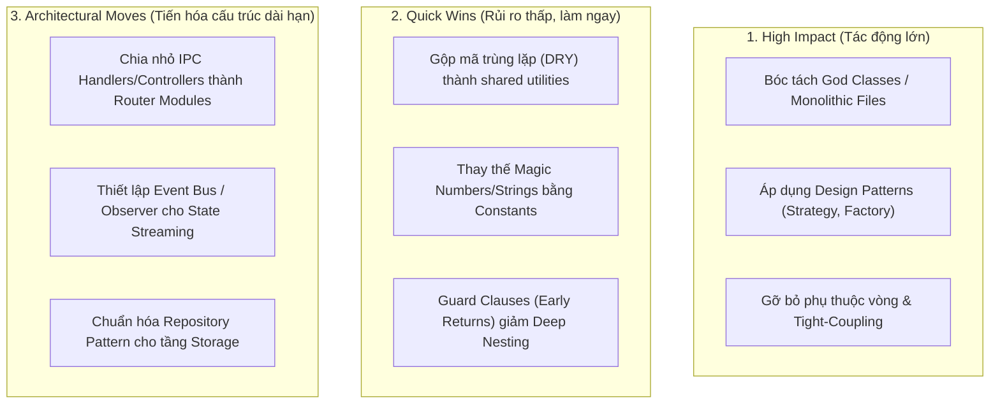
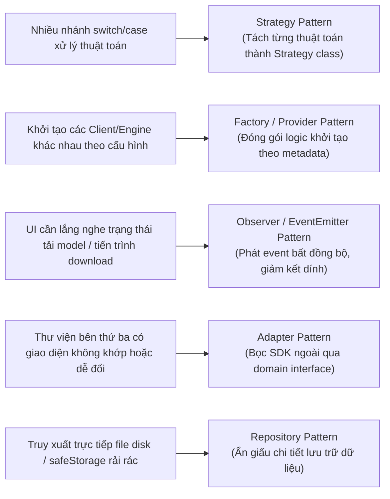

# Project Refactoring & SOLID Design Pattern Skill

Skill này cung cấp quy trình phân tích nợ kỹ thuật (technical debt), phát hiện các điểm vi phạm nguyên lý thiết kế phần mềm (SOLID), bóc tách các lớp/tệp khổng lồ (God classes/files) và đề xuất các mẫu thiết kế (**Design Patterns**) chuẩn mực từ Gang of Four (GoF) và Martin Fowler, kế thừa triết lý từ [florianbruniaux/claude-code-ultimate-guide](https://github.com/florianbruniaux/claude-code-ultimate-guide).

Mục tiêu cốt lõi: **Không viết code chắp vá (no band-aids). Đưa ra giải pháp tái cấu trúc bài bản, có tính module hóa cao, dễ mở rộng và kiểm thử, được phân tầng ưu tiên rõ ràng kèm kế hoạch an toàn tuyệt đối.**

---

## 1. Khung Phân loại Đề xuất 3 Cấp độ (Tri-Tier Refactoring Framework)

Mọi đề xuất tái cấu trúc từ skill này phải được phân loại rõ ràng vào 3 nhóm:



| Cấp độ | Đặc điểm | Độ rủi ro | Lợi ích mang lại |
| :--- | :--- | :--- | :--- |
| **High Impact** | Tái cấu trúc các thành phần cốt lõi, chuyển đổi logic phức tạp sang Design Patterns. | Trung bình (cần test kỹ) | Tăng mạnh khả năng bảo trì, mở rộng tính năng mới không cần sửa code cũ. |
| **Quick Wins** | Sửa các code smell cục bộ: tách hàm, trích xuất constant, xóa dead code, giảm lồng if/else. | Rất thấp | Cải thiện độ sạch của mã nguồn tức thì, không ảnh hưởng API contracts. |
| **Architectural Moves** | Thay đổi cách tổ chức phân tầng, cơ chế DI (Dependency Injection), Event-driven. | Cao (lộ trình từng bước) | Định hình nền móng kiến trúc bền vững cho tương lai. |

---

## 2. Tiêu chí Quét Lỗi & Dấu hiệu Nhận diện (Code Smell Heuristics)

### A. Quét Vi phạm Nguyên lý SOLID

#### 1. S - Single Responsibility Principle (Đơn trách nhiệm)
- **Dấu hiệu**:
  - Tập tin quá lớn (> 300 - 500 dòng code).
  - Class có quá nhiều phương thức (> 10 methods).
  - Tệp xử lý nhiều mối quan tâm (hỗn hợp: validation + IPC dispatch + business logic + disk I/O + UI formatting).
- **Ví dụ thực tế**: `src/main/ipc-handlers.ts` gánh toàn bộ controller, logic search, logic clone git, cache readme và quản lý bookmark trong cùng một tệp >1600 dòng.

#### 2. O - Open/Closed Principle (Mở để mở rộng, đóng để sửa đổi)
- **Dấu hiệu**:
  - Khối `switch (type)` hoặc chuỗi `if (type === 'A') ... else if (type === 'B')` dài dòng.
  - Mỗi khi thêm nhà cung cấp mới (ví dụ LLM provider, search filter, language parser), bắt buộc phải sửa trực tiếp hàm cốt lõi.
- **Giải pháp**: Thay thế bằng **Strategy Pattern** hoặc **Registry Pattern**.

#### 3. L - Liskov Substitution Principle (Thay thế Liskov)
- **Dấu hiệu**:
  - Class con ghi đè phương thức nhưng ném lỗi `throw new Error('Not supported')`.
  - Gọi hàm phải kiểm tra kiểu cụ thể trước: `if (client instanceof OllamaClient)`.

#### 4. I - Interface Segregation Principle (Phân tách Interface)
- **Dấu hiệu**:
  - Interface quá "béo" (fat interface) chứa hàng chục thuộc tính/phương thức.
  - Các lớp implement phải cài đặt những phương thức mà nó không bao giờ dùng.

#### 5. D - Dependency Inversion Principle (Đảo ngược phụ thuộc)
- **Dấu hiệu**:
  - Khởi tạo trực tiếp đối tượng phụ thuộc cụ thể (`new GitHubClient()`, `new SettingsStore()`) rải rác bên trong các hàm thay vì inject qua constructor hoặc factory.
  - Khiến việc viết unit test độc lập với mock trở nên khó khăn.

---

### B. Quét Mã Trùng lặp (DRY) & Code Smells

1. **Duplicate Patterns**: Logic validation, format chuỗi, hoặc gọi API giống nhau lặp lại ở 3 nơi trở lên.
2. **Deep Nesting**: Lồng `if/else`, `try/catch`, `callback` quá 4 cấp độ làm giảm khả năng đọc hiểu.
3. **Long Parameter List**: Hàm nhận nhiều hơn 4 tham số rời rạc (cần gom nhóm vào Parameter Object/DTO).

---

## 3. Bản đồ Ánh xạ Design Patterns Chuẩn mực

Thay vì viết code xử lý tình huống tạm bợ, agent áp dụng các mẫu thiết kế phù hợp:



### Ví dụ 1: Thay thế switch/case bằng Strategy Pattern
```typescript
// ❌ Trước (Vi phạm Open/Closed - Phải sửa hàm mỗi khi thêm sort mới):
function sortRepositories(repos: Repo[], sortKey: string) {
  if (sortKey === 'stars') repos.sort((a, b) => b.stars - a.stars);
  else if (sortKey === 'forks') repos.sort((a, b) => b.forks - a.forks);
  else if (sortKey === 'updated') repos.sort((a, b) => ...);
}

// ✅ Sau (Strategy Pattern - Mở rộng linh hoạt, độc lập test):
interface SortStrategy {
  sort(repos: Repo[]): Repo[];
}

const sortStrategies: Record<string, SortStrategy> = {
  stars: { sort: (repos) => [...repos].sort((a, b) => b.stars - a.stars) },
  forks: { sort: (repos) => [...repos].sort((a, b) => b.forks - a.forks) },
  updated: { sort: (repos) => [...repos].sort((a, b) => ...) },
};
```

### Ví dụ 2: Quản lý Providers bằng Factory Pattern
```typescript
// ✅ Factory Pattern kết hợp Dependency Inversion:
export class LlmClientFactory {
  static createClient(settings: AppSettings): ILlmClient {
    switch (settings.llmProvider) {
      case 'ollama':
        return new OllamaClient(settings.ollamaBaseUrl, settings.ollamaApiKey);
      case 'embedded':
        return llmManager.getEmbeddedEngine();
      default:
        throw new Error(`Unsupported provider: ${settings.llmProvider}`);
    }
  }
}
```

---

## 4. Quy trình Thực thi An toàn (Safe Refactoring Runbook)

Trước khi tiến hành sửa code, agent bắt buộc tuân thủ 5 bước an toàn:

1. **Baseline Verification**: Kích hoạt `autonomous-testing` chạy full test suite (`npm test`). Nếu test suite hiện tại đang fail, **dừng lại** và sửa bug trước khi refactor.
2. **Isolate Scope**: Chỉ thực hiện refactor cho một module tại một thời điểm.
3. **Preserve External API**: Giữ nguyên tên hàm, tham số và giá trị trả về của các public interfaces để không làm gãy các module phụ thuộc.
4. **Step-by-Step Execution**:
   - Bước 1: Trích xuất interface hoặc helper function.
   - Bước 2: Chuyển đổi implementation.
   - Bước 3: Thay thế các call site.
5. **Post-Refactor Regression Check**: Chạy lại toàn bộ test suite và lint check (`npm test && npm run lint`).

---

## 5. Mẫu Báo cáo Đánh giá Tái Cấu trúc (Refactoring Audit Report Template)

```markdown
# 🛠️ Codebase Refactoring & SOLID Assessment Report

### Tổng quan
- **Số tệp đã quét**: N tệp
- **Số điểm vi phạm phát hiện**: X (Y High Impact, Z Quick Wins, W Architectural Moves)
- **Điểm đánh giá SOLID chung**: [A | B | C | D | F]

---

### 📊 Bảng Điểm Nguyên Lý SOLID
| Nguyên lý | Trạng thái | Điểm nóng phát hiện | Mẫu thiết kế đề xuất |
| :--- | :--- | :--- | :--- |
| **S - Single Responsibility** | 🔴 Cần bóc tách | `src/main/ipc-handlers.ts` (>1600 lines) | Controller Decomposition / Modular Routers |
| **O - Open/Closed** | 🟡 Trung bình | Nhánh chọn thuật toán ranking | Strategy Pattern |
| **L - Liskov Substitution** | 🟢 Tốt | Tuân thủ interface `ILlmClient` | - |
| **I - Interface Segregation**| 🟢 Tốt | Các types và props được phân tách nhỏ | - |
| **D - Dependency Inversion** | 🟡 Trung bình | Khởi tạo trực tiếp store trong controller | Factory / Dependency Injection |

---

### 🎯 Danh mục Đề xuất Tái cấu trúc Theo Mức độ Ưu tiên

#### 1. High Impact (Tác động cốt lõi)
- **Hạng mục**: Bóc tách God file `src/main/ipc-handlers.ts`
- **Vấn đề**: File chứa hơn 1600 dòng bao gồm search, download model, bookmark, git clone.
- **Giải pháp**: Phân rã thành các handler module độc lập:
  - `src/main/handlers/search.handler.ts`
  - `src/main/handlers/clone.handler.ts`
  - `src/main/handlers/bookmark.handler.ts`
  - `src/main/handlers/settings.handler.ts`

#### 2. Quick Wins (Rủi ro thấp, giá trị nhanh)
- **Hạng mục**: Guard Clauses thay thế lồng if/else
- **Vấn đề**: Hàm `validateCloneInputs` có thể dùng early returns để làm phẳng luồng điều khiển.
- **Hạng mục**: Chuẩn hóa hằng số thời gian cache (`README_CACHE_TTL_MS`, `TIMEOUT_MS`).

#### 3. Architectural Moves (Tiến hóa dài hạn)
- **Hạng mục**: Chuẩn hóa Event-driven Communication cho tiến trình tải model và stream kết quả tìm kiếm.
- **Giải pháp**: Xây dựng Typed Event Bus giữa Main Process và Renderer.
```
