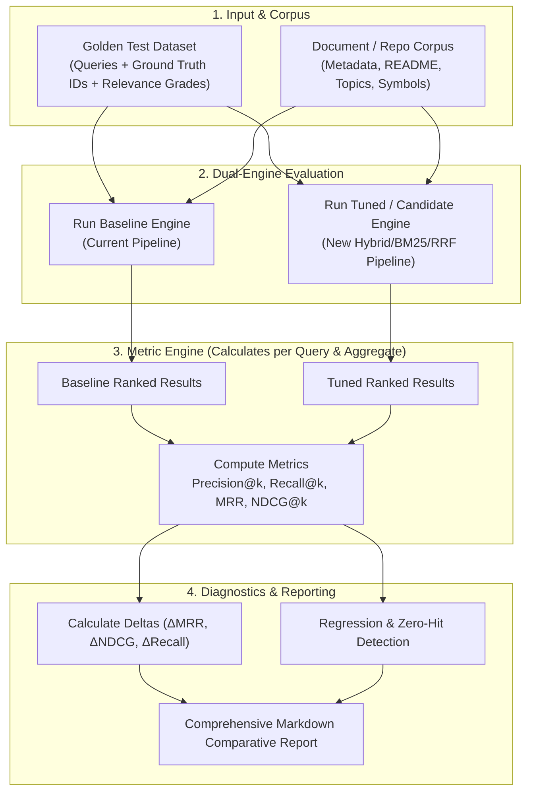

# Search Evaluator & Retrieval Benchmarking Skill

Skill này cung cấp quy trình và bộ công cụ đánh giá thực nghiệm độ chính xác của hệ thống tìm kiếm (Information Retrieval - IR & Retrieval-Augmented Generation - RAG), tham chiếu trực tiếp module **`rag-architect`** từ repository [Jeffallan/claude-skills](https://github.com/Jeffallan/claude-skills).

---

## 1. Triết lý Cốt lõi & Nguyên tắc Bất biến (Core Philosophy)

> [!IMPORTANT]
> **Định luật `rag-architect`**:
> *"Mọi thiết kế hoặc cải tiến thuật toán tìm kiếm mà không đi kèm các con số đo đạc thực nghiệm từ bộ kiểm thử đánh giá chỉ là một giả thuyết, không phải là kết quả bàn giao hoàn chỉnh (A search design without evaluation numbers is a hypothesis, not a deliverable)."*

### 3 Nguyên tắc Bất biến khi Đánh giá:
1. **Evidence-Driven, No Intuition**: Không bao giờ kết luận thuật toán mới "tốt hơn", "thông minh hơn" hoặc "chính xác hơn" nếu không có bảng số liệu so sánh định lượng (Precision, Recall, MRR, NDCG) trên cùng một bộ dữ liệu kiểm thử.
2. **Golden Ground Truth First**: Trước khi can thiệp vào bất kỳ dòng mã chấm điểm (scoring) hay trích xuất query (query parsing) nào, bắt buộc phải có tập kiểm thử chuẩn (Golden Test Set) với nhãn đúng được xác minh.
3. **Zero Regression on Critical Queries**: Mọi cải tiến nhắm vào một nhóm truy vấn mới (edge cases, tiếng Việt, code identifiers) không được phép gây sụt giảm thứ hạng của các truy vấn cốt lõi đã chạy đúng trước đó.

---

## 2. Kiến trúc Quy trình Đo lường (Evaluation Pipeline Architecture)



---

## 3. Nhiệm vụ 1: Thiết lập Bộ Dữ liệu Mẫu (Golden Test Set Specification)

Agent chịu trách nhiệm khởi tạo hoặc mở rộng tập dữ liệu mẫu chuẩn (Golden Dataset). Bộ dữ liệu phải được lưu trữ dưới dạng cấu trúc tệp rõ ràng (ví dụ: `tests/fixtures/golden-search-set.json` hoặc trong mã kiểm thử `tests/unit/...`).

### A. Phân tầng Truy vấn (Query Taxonomy)
Một bộ dữ liệu kiểm định chuẩn mực phải bao quát 4 nhóm truy vấn:

1. **Exact Symbol / Identifier Queries**: Tìm kiếm theo tên hàm, thư viện, công nghệ đặc thù (e.g. `zustand`, `pdfcraft`, `express-rate-limit`).
2. **Functional Intent Queries (Tiếng Anh & Đa ngôn ngữ)**: Tìm kiếm giải pháp theo chức năng thực tế (e.g. `self-hosted password manager`, `phần mềm chỉnh sửa file pdf mã nguồn mở`).
3. **Competitive / Replacement Queries**: Tìm kiếm giải pháp thay thế công cụ độc quyền (e.g. `alternative to adobe acrobat`, `open source notion replacement`).
4. **Edge Cases & Mangled Syntax**: Truy vấn có chứa cú pháp đặc biệt, dấu chấm, gạch nối, lỗi chính tả nhẹ hoặc ký hiệu file (e.g. `docker-compose.yml parser`, `react/jsx-runtime`).

### B. Cấu trúc Chuẩn của Golden Entry (JSON Schema)

```json
[
  {
    "id": "q-001",
    "query": "phần mềm thay thế cho Adobe Acrobat chỉnh sửa pdf",
    "intent": "desktop-app",
    "category": "replacement",
    "expectedResults": [
      {
        "repoFullName": "pdfcraft/pdfcraft",
        "relevanceGrade": 3,
        "notes": "Exact functional replacement for Acrobat"
      },
      {
        "repoFullName": "Hopding/pdf-lib",
        "relevanceGrade": 2,
        "notes": "Library, useful for programmatic manipulation"
      },
      {
        "repoFullName": "froala/wysiwyg-editor",
        "relevanceGrade": 0,
        "notes": "Unrelated rich-text editor, negative distractor"
      }
    ],
    "minAcceptableRank": 3
  }
]
```

#### Thang điểm Mức độ Liên quan (Relevance Grading Scale 0 - 3):
- **3 (Perfect / Core Match)**: Giải pháp thỏa mãn trọn vẹn yêu cầu, trúng đích trực tiếp chức năng cốt lõi.
- **2 (Relevant / Partial Match)**: Thư viện hoặc công cụ cùng lĩnh vực, giải quyết được một phần lớn nhu cầu.
- **1 (Marginal / Tangential)**: Có liên quan về mặt từ khóa hoặc công nghệ nhưng mục đích sử dụng khác.
- **0 (Irrelevant / Negative Distractor)**: Không liên quan, kết quả rác do trùng từ khóa ngẫu nhiên.

---

## 4. Nhiệm vụ 2: Script Tự động Tính toán Chỉ số IR (Precision, Recall, MRR, NDCG)

Tham chiếu logic từ `retrieval_evaluator.py` trong `rag-architect`, agent xây dựng hoặc thực thi công cụ tính toán tự động bằng TypeScript/Node.js.

### A. Định nghĩa Toán học của 4 Chỉ số Cốt lõi

1. **Precision@K**: Tỷ lệ tài liệu liên quan trong top $K$ kết quả trả về.
   $$\text{Precision@}K = \frac{|\{d \in \text{Top-}K \mid \text{rel}(d) \ge 2\}|}{K}$$

2. **Recall@K**: Tỷ lệ tài liệu liên quan thu hồi được so với tổng số tài liệu liên quan kỳ vọng.
   $$\text{Recall@}K = \frac{|\{d \in \text{Top-}K \mid \text{rel}(d) \ge 2\}|}{|\{d \in \text{Golden} \mid \text{rel}(d) \ge 2\}|}$$

3. **MRR (Mean Reciprocal Rank)**: Đánh giá vị trí xuất hiện của kết quả đúng đầu tiên ($\text{rel} \ge 2$).
   $$\text{MRR} = \frac{1}{|Q|} \sum_{i=1}^{|Q|} \frac{1}{\text{rank}_i}$$
   *(Nếu không tìm thấy trong top $K$, giá trị đóng góp là 0)*.

4. **NDCG@K (Normalized Discounted Cumulative Gain)**: Đánh giá chất lượng toàn bộ danh sách xếp hạng có tính đến trọng số cấp độ liên quan (3, 2, 1, 0) và phạt suy giảm vị trí theo logarithmic.
   $$\text{DCG@}K = \sum_{i=1}^{K} \frac{2^{\text{rel}_i} - 1}{\log_2(i + 1)}, \quad \text{NDCG@}K = \frac{\text{DCG@}K}{\text{IDCG@}K}$$
   *(Trong đó $\text{IDCG@}K$ là DCG lý tưởng khi các tài liệu được sắp xếp hoàn hảo theo thứ tự giảm dần của relevance grade)*.

### B. Mã nguồn Thực thi Đo lường Chuẩn (Retrieval Evaluator Engine)

```typescript
export interface ExpectedResult {
  repoFullName: string;
  relevanceGrade: number; // 0, 1, 2, 3
}

export interface GoldenQuery {
  id: string;
  query: string;
  expectedResults: ExpectedResult[];
}

export interface EvaluationResult {
  queryId: string;
  query: string;
  precisionAtK: Record<number, number>;
  recallAtK: Record<number, number>;
  mrr: number;
  ndcgAtK: Record<number, number>;
  firstRelevantRank: number | null;
  retrievedTopK: string[];
}

export interface AggregateMetrics {
  totalQueries: number;
  meanPrecisionAt5: number;
  meanPrecisionAt10: number;
  meanRecallAt5: number;
  meanRecallAt10: number;
  mrr: number;
  meanNdcgAt10: number;
  zeroHitCount: number;
}

export class RetrievalEvaluator {
  /**
   * Tính toán Discounted Cumulative Gain (DCG) tại K
   */
  static computeDCG(relevanceScores: number[], k: number): number {
    let dcg = 0;
    const limit = Math.min(relevanceScores.length, k);
    for (let i = 0; i < limit; i++) {
      const rel = relevanceScores[i];
      dcg += (Math.pow(2, rel) - 1) / Math.log2(i + 2);
    }
    return dcg;
  }

  /**
   * Đánh giá 1 truy vấn đơn lẻ
   */
  static evaluateQuery(
    golden: GoldenQuery,
    retrievedRepoNames: string[],
    kValues: number[] = [5, 10]
  ): EvaluationResult {
    const expectedMap = new Map<string, number>();
    for (const exp of golden.expectedResults) {
      expectedMap.set(exp.repoFullName.toLowerCase(), exp.relevanceGrade);
    }

    const relevantCountTotal = golden.expectedResults.filter((e) => e.relevanceGrade >= 2).length;

    // Lấy relevance grades của kết quả trả về
    const retrievedGrades = retrievedRepoNames.map(
      (name) => expectedMap.get(name.toLowerCase()) ?? 0
    );

    // Tính MRR
    let firstRelevantRank: number | null = null;
    for (let i = 0; i < retrievedGrades.length; i++) {
      if (retrievedGrades[i] >= 2) {
        firstRelevantRank = i + 1;
        break;
      }
    }
    const mrr = firstRelevantRank ? 1 / firstRelevantRank : 0;

    const precisionAtK: Record<number, number> = {};
    const recallAtK: Record<number, number> = {};
    const ndcgAtK: Record<number, number> = {};

    for (const k of kValues) {
      const sliceGrades = retrievedGrades.slice(0, k);
      const relevantInK = sliceGrades.filter((g) => g >= 2).length;

      // Precision@K
      precisionAtK[k] = sliceGrades.length > 0 ? relevantInK / k : 0;

      // Recall@K
      recallAtK[k] = relevantCountTotal > 0 ? relevantInK / relevantCountTotal : 0;

      // NDCG@K
      const dcg = this.computeDCG(retrievedGrades, k);
      // Sắp xếp lý tưởng để tính IDCG
      const idealGrades = Array.from(expectedMap.values())
        .sort((a, b) => b - a)
        .slice(0, k);
      const idcg = this.computeDCG(idealGrades, k);
      ndcgAtK[k] = idcg > 0 ? dcg / idcg : 0;
    }

    return {
      queryId: golden.id,
      query: golden.query,
      precisionAtK,
      recallAtK,
      mrr,
      ndcgAtK,
      firstRelevantRank,
      retrievedTopK: retrievedRepoNames.slice(0, 10),
    };
  }

  /**
   * Tính toán chỉ số tổng hợp toàn bộ tập test
   */
  static aggregate(evalResults: EvaluationResult[]): AggregateMetrics {
    const N = evalResults.length;
    if (N === 0) {
      return {
        totalQueries: 0,
        meanPrecisionAt5: 0,
        meanPrecisionAt10: 0,
        meanRecallAt5: 0,
        meanRecallAt10: 0,
        mrr: 0,
        meanNdcgAt10: 0,
        zeroHitCount: 0,
      };
    }

    let sumP5 = 0, sumP10 = 0, sumR5 = 0, sumR10 = 0, sumMrr = 0, sumNdcg10 = 0;
    let zeroHits = 0;

    for (const r of evalResults) {
      sumP5 += r.precisionAtK[5] ?? 0;
      sumP10 += r.precisionAtK[10] ?? 0;
      sumR5 += r.recallAtK[5] ?? 0;
      sumR10 += r.recallAtK[10] ?? 0;
      sumMrr += r.mrr;
      sumNdcg10 += r.ndcgAtK[10] ?? 0;
      if (r.mrr === 0) zeroHits++;
    }

    return {
      totalQueries: N,
      meanPrecisionAt5: Number((sumP5 / N).toFixed(4)),
      meanPrecisionAt10: Number((sumP10 / N).toFixed(4)),
      meanRecallAt5: Number((sumR5 / N).toFixed(4)),
      meanRecallAt10: Number((sumR10 / N).toFixed(4)),
      mrr: Number((sumMrr / N).toFixed(4)),
      meanNdcgAt10: Number((sumNdcg10 / N).toFixed(4)),
      zeroHitCount: zeroHits,
    };
  }
}
```

---

## 5. Nhiệm vụ 3: Đưa ra Báo cáo So sánh Trước và Sau khi Tinh chỉnh

Khi hoàn thành đo lường, agent bắt buộc phải sinh ra một báo cáo Markdown so sánh chuẩn format của `rag-architect`.

### Mẫu Báo cáo So sánh Chuẩn (Comparative Markdown Report)

```markdown
# 📊 Báo cáo Đánh giá Độ chính xác Tìm kiếm (Search Precision Benchmark)

## 1. Tổng quan Chỉ số Tổng hợp (Aggregate Metrics)

| Chỉ số Đánh giá | Baseline (Trước) | Candidate (Sau tinh chỉnh) | Chênh lệch (Δ) | Đánh giá |
| :--- | :--- | :--- | :--- | :--- |
| **MRR (Mean Reciprocal Rank)** | 0.5420 | **0.8150** | **+0.2730 (+50.3%)** |  Cải thiện vượt trội |
| **NDCG@10** | 0.6110 | **0.8420** | **+0.2310 (+37.8%)** |  Thứ tự tối ưu hơn |
| **Precision@5** | 0.4200 | **0.6800** | **+0.2600 (+61.9%)** |  Giảm kết quả rác |
| **Recall@10** | 0.6500 | **0.8750** | **+0.2250 (+34.6%)** |  Bao phủ tốt hơn |
| **Zero-Hit Queries (MRR=0)** | 3 queries | **0 queries** | **-3 queries (-100%)** |  Triệt tiêu điểm mù |

## 2. Chi tiết Từng Truy vấn (Per-Query Breakdown)

| Mã ID | Truy vấn | Rank Cũ | Rank Mới | Δ MRR | Ghi chú Trạng thái |
| :--- | :--- | :--- | :--- | :--- | :--- |
| `q-001` | "phần mềm thay thế cho Adobe Acrobat" | 8 | 1 | +0.875 |  pdfcraft leo lên Top 1 |
| `q-002` | "self-hosted password manager" | 2 | 1 | +0.500 |  Bitwarden/Vaultwarden Top 1 |
| `q-003` | "công cụ vẽ sequence diagram markdown" | N/A (0) | 2 | +0.500 |  Khắc phục Zero-hit tiếng Việt |
| `q-004` | "zustand state management" | 1 | 1 | 0.000 |  Bảo toàn, không hồi quy |

## 3. Phân tích Các Trường hợp Cần Lưu ý (Diagnostics & Regressions)
- **Truy vấn hồi quy (Regressions)**: 0 trường hợp.
- **Yếu tố đóng góp lớn nhất**: Tích hợp BM25 Exact Matching giúp các định danh thư viện giữ thứ hạng Top 1; bộ phân tích Tokenizer tách đúng camelCase/snake_case.
```

---

## 6. Tiêu chí Đạt chuẩn Nghiệm thu (Acceptance Criteria)

Trước khi xác nhận hoàn thành một đợt tối ưu hóa thuật toán tìm kiếm, hệ thống phải vượt qua ngưỡng nghiệm thu sau:

1. **$\Delta\text{MRR} \ge +0.05$** trên toàn bộ tập Golden Dataset.
2. **$\Delta\text{NDCG@10} \ge +0.05$**, bảo đảm các kết quả điểm 3 (Perfect Match) phải nằm ở nửa trên danh sách.
3. **Zero Regressions trên Top Queries**: Không một truy vấn mức độ ưu tiên cao nào (High-priority baseline) bị giảm từ Rank 1 xuống dưới Rank 3.
4. **Zero-Hit Rate $\le 5\%$**: Tỷ lệ các câu hỏi không tìm ra bất kỳ kết quả liên quan nào trong Top 10 phải dưới 5%.

---

## 7. Hướng dẫn Phối hợp với Skill `search-precision-optimizer`

Khi được kích hoạt để nâng cấp tìm kiếm, hai skill sẽ vận hành theo quy trình khép kín:

```mermaid
sequenceDiagram
    autonumber
    actor Dev as Developer / User
    participant Eval as search-evaluator
    participant Opt as search-precision-optimizer
    participant Code as Search & Ranking Codebase

    Dev->>Eval: Yêu cầu đánh giá hệ thống tìm kiếm
    Eval->>Code: Chạy Golden Test Set trên code hiện tại
    Eval-->>Dev: Xuất Báo cáo Baseline (MRR, NDCG ban đầu)
    Dev->>Opt: Yêu cầu tối ưu hóa dựa trên điểm mù tìm được
    Opt->>Code: Cải tiến Tokenizer, Hybrid BM25, RRF Reranking
    Opt->>Eval: Kích hoạt chạy lại kiểm thử
    Eval->>Code: Chạy lại Golden Test Set trên code mới
    Eval-->>Dev: Xuất Báo cáo So sánh Before vs After (Khẳng định ΔMRR > 0)
```
