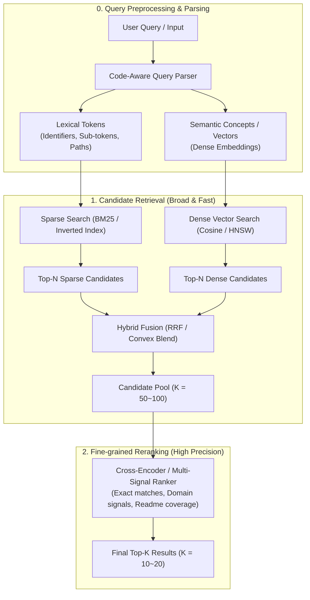
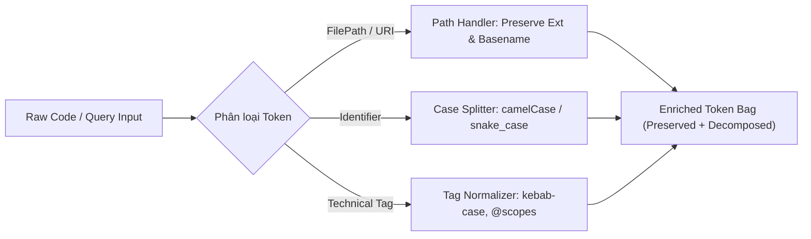
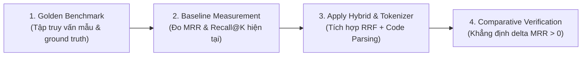

# Search Precision Optimizer Skill

Skill này cung cấp phương pháp luận tối ưu hóa hiệu năng và độ chính xác truy xuất thông tin (Information Retrieval - IR & Retrieval-Augmented Generation - RAG), tham chiếu kiến trúc và quy chuẩn từ repository [Goodnight77/rag-skills](https://github.com/Goodnight77/rag-skills).

Mục tiêu cốt lõi: **Xóa bỏ hiện tượng điểm mù từ vựng (vocabulary mismatch) và độ trôi ngữ nghĩa (semantic drift), kết hợp sức mạnh giữa khớp chính xác ký hiệu code (lexical/BM25) và hiểu sâu ngữ cảnh (dense embeddings), từ đó tối ưu hóa Precision@K, Recall@K và MRR cho hệ thống tìm kiếm mã nguồn và tài liệu kỹ thuật.**

---

## 1. Kiến trúc Tổng thể: Pipeline Truy xuất Đa tầng (Two-Stage Hybrid Pipeline)

Quy trình truy xuất chuẩn mực được tổ chức theo mô hình 2 giai đoạn (Two-Stage Retrieval):



---

## 2. Nhiệm vụ 1: Đánh giá Pipeline Tìm kiếm Hiện tại (Retrieval Audit Framework)

Khi nhận lệnh kiểm tra hoặc nâng cấp hệ thống tìm kiếm của dự án, agent phải thực hiện audit có hệ thống theo 4 khía cạnh sau:

### A. Kiểm kê Kiến trúc Tìm kiếm Hiện tại (Architecture Inventory)
1. **Phương thức sinh ứng viên (Candidate Generation)**:
   - Hệ thống dùng Keyword matching thuần túy (`Array.filter`, regex, SQL `LIKE`) hay API Query (GitHub Search API, ElasticSearch)?
   - Có cơ chế Dense Vector Search (Chroma, Qdrant, LanceDB, pgvector, in-memory cosine) không?
   - Danh sách ứng viên thu thập ban đầu ($N$) có đủ lớn để bao phủ các kết quả tiềm năng không ($N \ge 50$)?
2. **Chiến lược tính điểm phù hợp (Scoring Strategy)**:
   - Điểm số được tính bằng cách đếm từ thô (raw hit count) hay dùng thuật toán chuẩn (BM25, TF-IDF)?
   - Có bị hiện tượng "sao chép star count" hoặc "gian lận từ khóa" (keyword-stuffing) lấn át độ phù hợp thực tế không?
   - Các trọng số (weights) có bị gán cứng (hardcoded) thiếu tính thích nghi theo ngữ cảnh người dùng không?

### B. Bảng Chỉ số Đánh giá Chất lượng (IR Evaluation Metrics)

Agent cần thiết lập hoặc đo lường các chỉ số định lượng sau trên tập dữ liệu benchmark:

| Chỉ số | Ý nghĩa | Công thức | Tiêu chuẩn chất lượng |
| :--- | :--- | :--- | :--- |
| **Recall@K** | Tỷ lệ tài liệu liên quan thực tế được tìm thấy trong top $K$. | $\frac{\|\text{Relevant} \cap \text{Top-K}\|}{\|\text{Relevant}\|}$ | $\ge 85\%$ tại $K=20$ |
| **Precision@K** | Tỷ lệ tài liệu thực sự đúng trong số $K$ kết quả trả về. | $\frac{\|\text{Relevant} \cap \text{Top-K}\|}{K}$ | $\ge 70\%$ tại $K=5$ |
| **MRR (Mean Reciprocal Rank)** | Đánh giá vị trí xuất hiện của kết quả đúng đầu tiên. | $\frac{1}{\|Q\|} \sum_{i=1}^{\|Q\|} \frac{1}{\text{rank}_i}$ | $\ge 0.75$ |
| **NDCG@K** | Đánh giá thứ hạng có trọng số (kết quả hay nhất phải nằm trên cùng). | $\frac{\text{DCG}_K}{\text{IDCG}_K}$ | $\ge 0.80$ tại $K=10$ |
| **Latency Budget** | Thời gian phản hồi hoàn tất pipeline truy xuất. | $p50, p95$ | $p50 \le 200\text{ms}, p95 \le 800\text{ms}$ |

### C. Nhận diện 4 Điểm mù Truy xuất (Common Retrieval Traps)
- **Vocabulary Mismatch**: Người dùng tìm "auth middleware", code viết `jwtVerifyHandler` $\rightarrow$ Lexical search trượt hoàn toàn.
- **Semantic Drift (Lạc ngữ cảnh vector)**: Vector search tìm khái niệm tương tự nhưng bỏ qua các mã lỗi cụ thể (ví dụ: `ERR_HTTP_HEADERS_SENT` bị map nhầm sang bài viết giải thích HTTP chung chung).
- **Popularity Bias**: Repositories nhiều sao hoặc bài viết dài lấn át các giải pháp gọn nhẹ, trúng đích.
- **Code Mangling**: Tokenizer cắt xén dấu chấm, gạch dưới, gạch nối làm hỏng các identifier (`react-dom`, `@nestjs/core`, `os.path.join`).

---

## 3. Nhiệm vụ 2: Tích hợp Hybrid Search & Reranking Engine

Tham chiếu phương pháp luận từ `skills/retrieval-strategies/hybrid-search-bm25-dense` và `skills/retrieval-strategies/multi-pass-retrieval-with-reranking` của Goodnight77/rag-skills.

### A. Cơ chế Hybrid Search (Sparse + Dense Retrieval)

Sự kết hợp giữa 2 trường phái giải quyết bài toán bổ trợ lẫn nhau:
- **Sparse (BM25 / Token Inverted Index)**: Vô địch về khớp chính xác (Exact match), tên hàm, tên file, error codes, unique identifiers.
- **Dense (Semantic Vector Search)**: Vô địch về mở rộng từ đồng nghĩa, hiểu mục tiêu hành động (intent), xử lý câu hỏi tự nhiên hoặc ngôn ngữ chéo (multilingual).

```
Candidate Pool = Top-N(Sparse BM25) ∪ Top-N(Dense Embeddings)
```

### B. Thuật toán Hợp nhất Thứ hạng: Reciprocal Rank Fusion (RRF)

Không nên cộng trực tiếp điểm số BM25 (thường không có cận trên) với Cosine Similarity ($[0, 1]$) nếu chưa chuẩn hóa. **RRF** là thuật toán xếp hạng phi tham số (parameter-free), bền vững nhất để hợp nhất hai luồng kết quả:

$$\text{RRF\_Score}(d) = \sum_{m \in M} \frac{w_m}{k + \text{rank}_m(d)}$$

- $M$: Tập các hệ thống xếp hạng ($M = \{\text{Sparse}, \text{Dense}\}$).
- $\text{rank}_m(d)$: Thứ hạng của tài liệu $d$ trong hệ thống $m$ (bắt đầu từ 1). Nếu không có trong top của hệ thống $m$, $\text{rank}_m(d) \to \infty$.
- $k$: Hằng số làm mượt (Smoothing constant), giá trị chuẩn theo thực nghiệm IR là **$k = 60$** (ngăn các tài liệu đứng đầu áp đảo hoàn toàn).
- $w_m$: Trọng số kênh (mặc định $w_{\text{sparse}} = 1.0, w_{\text{dense}} = 1.0$, có thể điều chỉnh tùy use-case).

#### TypeScript Implementation Pattern cho RRF:

```typescript
export interface RankedItem<T> {
  item: T;
  id: string | number;
  rank: number;
  score?: number;
}

export function reciprocalRankFusion<T>(
  sparseRankings: RankedItem<T>[],
  denseRankings: RankedItem<T>[],
  k = 60,
  sparseWeight = 1.0,
  denseWeight = 1.0
): { item: T; id: string | number; rrfScore: number }[] {
  const scoreMap = new Map<string | number, { item: T; rrfScore: number }>();

  // Xử lý danh sách Sparse
  for (const entry of sparseRankings) {
    const contribution = sparseWeight / (k + entry.rank);
    const existing = scoreMap.get(entry.id);
    if (existing) {
      existing.rrfScore += contribution;
    } else {
      scoreMap.set(entry.id, { item: entry.item, rrfScore: contribution });
    }
  }

  // Xử lý danh sách Dense
  for (const entry of denseRankings) {
    const contribution = denseWeight / (k + entry.rank);
    const existing = scoreMap.get(entry.id);
    if (existing) {
      existing.rrfScore += contribution;
    } else {
      scoreMap.set(entry.id, { item: entry.item, rrfScore: contribution });
    }
  }

  // Chuyển đổi và sắp xếp giảm dần theo RRF score
  return Array.from(scoreMap.entries())
    .map(([id, val]) => ({ id, item: val.item, rrfScore: val.rrfScore }))
    .sort((a, b) => b.rrfScore - a.rrfScore);
}
```

### C. Thuật toán Reranking (Multi-Pass / Cross-Encoder)

Sau khi giai đoạn 1 lấy ra $N \approx 50$ ứng viên thông qua Hybrid Search, giai đoạn 2 áp dụng mô hình chấm điểm chi tiết:

1. **Cross-Encoder Model** (khi có môi trường ML/AI service):
   - Thay vì mã hóa tách biệt $E(\text{Query})$ và $E(\text{Doc})$ như Bi-Encoder, Cross-Encoder đưa trực tiếp cặp `(Query, Doc)` vào transformer layers để các token query và doc tương tác qua full self-attention.
   - Thích hợp: `bge-reranker-large`, `ms-marco-MiniLM-L-6-v2`, `cohere-rerank-v3`.
2. **Deterministic Domain Reranker** (trong client/desktop nhẹ không có GPU):
   - Phân rã văn bản tài liệu thành các trường đặc thù: Tiêu đề/Repo slug, Mô tả ngắn, Danh sách symbols/topics, Trích đoạn README chứa query terms.
   - Áp dụng các tín hiệu kiểm chứng:
     - Exact match của query tokens trong Identifier (hệ số $1.5\times$).
     - Độ bao phủ liên tục (Phrase proximity: các từ khóa đứng liền kề nhau).
     - Freshness signal (thời gian cập nhật gần nhất) kết hợp Activity discount.

---

## 4. Nhiệm vụ 3: Cải tiến Tokenizer & Query Parser cho Ký hiệu Code

Hầu hết tokenizer văn bản thông thường (như `split(/\s+/)` kết hợp stop words phổ thông) sẽ phá hỏng các ký tự lập trình và đường dẫn tệp.

### A. Các Thách thức Đặc thù của Code Tokenization

| Dạng dữ liệu | Tokenizer thông thường | Hậu quả | Chuẩn Tokenizer lập trình yêu cầu |
| :--- | :--- | :--- | :--- |
| **camelCase / PascalCase** | `getUserById` | Chỉ match được `getuserbyid`, trượt `user` hoặc `id` | Giữ nguyên gốc + tách sub-tokens: `['getUserById', 'get', 'user', 'by', 'id']` |
| **snake_case / CONSTANT** | `MAX_RETRY_COUNT` | Bị coi là 1 từ duy nhất | `['MAX_RETRY_COUNT', 'max', 'retry', 'count']` |
| **File Path** | `src/main/ranking/engine.ts` | Bị cắt nát hoặc giữ nguyên cả path | Giữ `full_path` + trích basename (`engine.ts`), extension (`.ts`), directory components |
| **Scoped Packages** | `@nestjs/common` | Xóa mất ký tự `@` hoặc `/` | Giữ nguyên scope `@nestjs/common` + token `nestjs`, `common` |
| **Version Strings** | `v18.12.0`, `>=2.0` | Bị regex lọc số/dấu bỏ qua | Nhận diện semver string nguyên vẹn |
| **Programming Stop Words** | `for`, `in`, `while`, `as`, `is` | Bị xóa vì trùng Natural Language stop words | Giữ lại nếu đứng trong ngữ cảnh code syntax query |

### B. Kiến trúc Bộ Tokenizer Đa chế độ (Code-Aware Tokenizer)

Bộ tokenizer cho tìm kiếm code và repo phải phân tách theo cấu trúc 3 luồng:



#### TypeScript Implementation Pattern:

```typescript
/**
 * Danh sách stop words tự nhiên thông thường.
 * CHÚ Ý: KHÔNG đưa các từ khóa lập trình cốt lõi vào đây (như 'for', 'in', 'class', 'type', 'interface', 'as')
 * nếu không có bộ kiểm tra ngữ cảnh.
 */
const NATURAL_STOP_WORDS = new Set([
  'the', 'a', 'an', 'and', 'or', 'to', 'of', 'at', 'by', 'from',
  'tôi', 'muốn', 'cần', 'cho', 'với', 'trong', 'về', 'các', 'những'
]);

export interface ParsedTokens {
  exactPhrases: string[];
  identifiers: string[];
  filePaths: string[];
  subTokens: string[];
  allNormalized: string[];
}

export class CodeAwareTokenizer {
  /**
   * Bóc tách các chuỗi camelCase hoặc PascalCase thành mảng các từ đơn
   */
  static splitCamelCase(word: string): string[] {
    return word
      .replace(/([a-z])([A-Z])/g, '$1 $2')
      .replace(/([A-Z]+)([A-Z][a-z])/g, '$1 $2')
      .toLowerCase()
      .split(/\s+/)
      .filter((w) => w.length >= 2);
  }

  /**
   * Phân tích query hoặc nội dung kỹ thuật thành token phong phú
   */
  static tokenize(input: string): ParsedTokens {
    const result: ParsedTokens = {
      exactPhrases: [],
      identifiers: [],
      filePaths: [],
      subTokens: [],
      allNormalized: []
    };

    if (!input || !input.trim()) return result;

    const normalizedBag = new Set<string>();

    // 1. Trích xuất exact phrases trong ngoặc kép "..."
    const phraseRegex = /"([^"]+)"/g;
    let match: RegExpExecArray | null;
    let cleanInput = input;
    while ((match = phraseRegex.exec(input)) !== null) {
      const phrase = match[1].toLowerCase().trim();
      if (phrase) {
        result.exactPhrases.push(phrase);
        normalizedBag.add(phrase);
      }
    }
    cleanInput = cleanInput.replace(phraseRegex, ' ');

    // 2. Nhận diện file paths (vd: src/main/engine.ts hoặc package.json)
    const filePathRegex = /([\w.-]+\/[\w.-]+\.[\w]+|[\w.-]+\.(ts|js|jsx|tsx|py|rs|go|json|yaml|yml|md|sql))/gi;
    while ((match = filePathRegex.exec(cleanInput)) !== null) {
      const pathStr = match[0].toLowerCase();
      result.filePaths.push(pathStr);
      normalizedBag.add(pathStr);
      // Tách basename và extension
      const parts = pathStr.split('/');
      const basename = parts[parts.length - 1];
      normalizedBag.add(basename);
      const ext = basename.includes('.') ? basename.split('.').pop()! : '';
      if (ext) normalizedBag.add(`.${ext}`);
    }

    // 3. Tách từ theo khoảng trắng và phân tích identifier
    const words = cleanInput.split(/[\s,;!()\[\]{}]+/).filter(Boolean);

    for (const raw of words) {
      const lower = raw.toLowerCase();
      if (NATURAL_STOP_WORDS.has(lower) && !raw.includes('_') && !raw.includes('.')) {
        continue;
      }

      // Giữ nguyên từ gốc
      normalizedBag.add(lower);

      // Phân tích snake_case hoặc kebab-case
      if (raw.includes('_') || raw.includes('-')) {
        result.identifiers.push(raw);
        const parts = raw.split(/[_-]+/).filter((p) => p.length >= 2);
        for (const p of parts) {
          result.subTokens.push(p.toLowerCase());
          normalizedBag.add(p.toLowerCase());
        }
      }

      // Phân tích camelCase / PascalCase
      if (/[a-z][A-Z]/.test(raw) || /[A-Z]{2,}[a-z]/.test(raw)) {
        result.identifiers.push(raw);
        const subWords = CodeAwareTokenizer.splitCamelCase(raw);
        for (const sw of subWords) {
          result.subTokens.push(sw);
          normalizedBag.add(sw);
        }
      }

      // Phân tích Dot-notation (vd: app.service.ts, user.profile)
      if (raw.includes('.') && !raw.startsWith('.')) {
        const parts = raw.split('.').filter((p) => p.length >= 2);
        for (const p of parts) {
          normalizedBag.add(p.toLowerCase());
        }
      }
    }

    result.allNormalized = Array.from(normalizedBag);
    return result;
  }
}
```

---

## 5. Quy trình Kiểm thử & Xác thực Tối ưu Truy xuất (Precision Tuning Workflow)

Khi ứng dụng skill này vào dự án, agent phải tuân thủ chu trình 4 bước kiểm chứng:



### Bước 1: Xây dựng Bộ Dữ liệu Kiểm thử (Golden Query Set)
Tập kiểm thử tối thiểu 10 - 20 truy vấn đại diện cho 4 tình huống:
1. **Truy vấn định danh code chính xác**: `createContext`, `docker-compose.yml`, `jwt.verify`.
2. **Truy vấn khái niệm kỹ thuật tự nhiên**: `công cụ theo dõi metric hệ thống`, `self-hosted git server`.
3. **Truy vấn kết hợp ngôn ngữ chéo**: `quản lý trạng thái react`, `fullstack typescript boilerplate`.
4. **Truy vấn tên thư viện / package**: `@tanstack/react-query`, `lucide-react`.

### Bước 2: Đo lường Đường cơ sở (Baseline Assessment)
Chạy bộ query qua pipeline hiện tại và ghi lại:
- Vị trí (Rank) của repo hoặc file đúng đầu tiên ($1/\text{rank}$).
- Số lượng kết quả rác xuất hiện trong Top 5.
- Thời gian thực thi trung bình.

### Bước 3: Cấu hình và Tinh chỉnh
- Nạp bộ `CodeAwareTokenizer` vào điểm phân tích query.
- Thay thế cơ chế tính điểm rời rạc bằng `RRF` hoặc `Convex Combination` (ví dụ: $0.6 \times \text{BM25} + 0.4 \times \text{DenseVector}$).
- Tinh chỉnh hằng số làm mượt $k$ ($40 \le k \le 80$, mặc định $60$).

### Bước 4: So sánh và Báo cáo Kết quả (Verification Report)
Xuất bảng so sánh Before vs After:
- $\Delta\text{MRR} = \text{MRR}_{\text{new}} - \text{MRR}_{\text{old}}$ (bắt buộc $\ge 0$).
- Tỷ lệ giảm Zero-Hit queries.
- Bằng chứng kiểm thử cụ thể từ các file test trong repository (`tests/unit/...`).

---

## 6. Ma trận Quyết định & Bảng Tra cứu Nhanh (Decision Matrix)

| Kịch bản Truy xuất | Cơ chế Ưu tiên | Phương pháp Reranking | Cấu hình Tokenizer |
| :--- | :--- | :--- | :--- |
| **Tìm kiếm Symbol, Hàm, API trong Codebase** | Sparse BM25 (Trọng số 80%) + Dense (20%) | Exact Match Boost + Line Proximity | Identifier Splitting (camelCase, snake_case) |
| **Tìm kiếm Kho lưu trữ GitHub / Dự án (Repo Search)** | Hybrid Search 50/50 qua RRF | Multi-Signal (Stars, Readme coverage, Topic match) | Slugs, Topic normalization, Diacritics stripping |
| **Hỏi đáp Tài liệu Kỹ thuật (Tech Docs RAG)** | Dense Search (70%) + Sparse (30%) | Cross-Encoder Reranker (`bge-reranker`) | Phrase preservation, Section header weighting |
| **Tìm kiếm File Path & Config** | Exact Pattern & Token Inverted Index | Path Depth & Exact Basename Match | File Extension preservation, Path splitting |

---

## 7. Quy tắc Thực thi Dành cho Agent (Agent Rules of Engagement)

> [!IMPORTANT]
> 1. **Bảo tồn Stop Words Kỹ thuật**: Tuyệt đối không sử dụng bộ `stopwords` mặc định của thư viện NLP tiếng Anh chung chung mà chưa loại bỏ các từ khóa lập trình (`for`, `in`, `if`, `while`, `type`, `class`).
> 2. **Không phụ thuộc thuần túy vào Vector Search**: Vector embedding có thể rất kém trong việc phân biệt các phiên bản (`v1` vs `v2`) hoặc các tên hàm tương tự (`useState` vs `useEffect`). Luôn phải có lớp Lexical/BM25 bảo vệ.
> 3. **RRF là Lựa chọn An toàn Nhất**: Khi kết hợp các nguồn điểm không đồng nhất (Unnormalized Scores), luôn ưu tiên thuật toán RRF trước khi thử nghiệm chuẩn hóa Min-Max hay Z-Score vốn dễ bị ảnh hưởng bởi giá trị ngoại lai (outliers).
> 4. **Tất cả các đề xuất tối ưu phải có dẫn chứng mã nguồn thực tế**: Chỉ rõ file và dòng cần thay đổi trong codebase hiện tại (ví dụ: `src/main/ranking/engine.ts`, `src/main/search/intent-decomposer.ts`).
