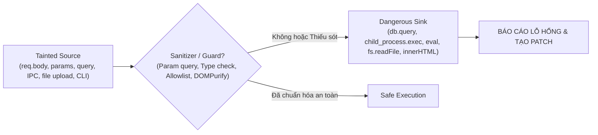

# Security SAST & Automated Vulnerability Remediation (Semgrep-Style)

Skill này cung cấp quy trình phân tích tĩnh bảo mật chuyên sâu (SAST - Static Application Security Testing) và tự động tạo bản vá code trực tiếp, kế thừa triết lý **Rule-based Pattern Matching & Taint Analysis (Source-to-Sink)** từ [Semgrep](https://github.com/semgrep/semgrep).

Mục tiêu cốt lõi: **Không chỉ phát hiện lỗ hổng mà phải phân tích chính xác luồng dữ liệu ô nhiễm (taint flow), đưa ra đánh giá rủi ro (CWE/OWASP) và trực tiếp áp dụng bản vá (patch) chuẩn sản xuất mà không làm gãy tính năng hiện có.**

---

## 1. Cơ chế Taint Analysis (Source - Sanitizer - Sink)

Tất cả các cuộc kiểm tra an ninh trong skill này đều dựa trên mô hình luồng dữ liệu độc hại của Semgrep:



1. **Source**: Điểm đầu vào do người dùng hoặc dữ liệu bên ngoài kiểm soát.
2. **Sink**: Hàm/phương thức thực thi nguy hiểm có thể gây hại nếu nhận dữ liệu không đáng tin cậy.
3. **Sanitizer / Validator**: Cơ chế xác thực, làm sạch, escape hoặc ràng buộc dữ liệu. Nếu luồng từ Source đến Sink không đi qua Sanitizer hợp lệ, đó là một **vulnerability**.

---

## 2. Danh mục Lỗ hổng Trọng tâm & Quy tắc Nhận diện

### A. SQL Injection (SQLi) - CWE-89 (OWASP A03: Injection)

- **Nguyên nhân**: Nối chuỗi, format string trực tiếp dữ liệu từ Source vào câu lệnh SQL.
- **Sinks nguy hiểm**: `db.query(sql)`, `connection.execute(sql)`, `knex.raw(sql)`, `sequelize.query(sql)`, `sqlite3.all(sql)`.
- **Semgrep Pattern logic**:
  ```yaml
  pattern-either:
    - pattern: $DB.query("..." + $X + "...")
    - pattern: $DB.query(`...${$X}...`)
    - pattern: $DB.execute(String.format("...", $X))
  ```
- **Chuẩn vá lỗi (Patching Recipe)**:
  - Chuyển 100% sang **Parameterized Queries** / Prepared Statements (dùng `$1, $2` hoặc `?`).
  - Sử dụng ORM/Query Builder an toàn với schema validation.

---

### B. Remote Code Execution (RCE) & Command Injection - CWE-78 / CWE-94

- **Nguyên nhân**: Truyền dữ liệu chưa lọc vào shell system hoặc runtime execution.
- **Sinks nguy hiểm**:
  - Node.js / JS: `child_process.exec(cmd)`, `eval(str)`, `new Function(...)`, `vm.runInContext()`.
  - Python: `os.system()`, `subprocess.Popen(..., shell=True)`, `eval()`, `exec()`.
- **Semgrep Pattern logic**:
  ```yaml
  pattern-either:
    - pattern: exec("..." + $INPUT + "...")
    - pattern: exec(`...${$INPUT}...`)
    - pattern: eval($INPUT)
    - pattern: subprocess.Popen($CMD, shell=True)
  ```
- **Chuẩn vá lỗi (Patching Recipe)**:
  - Thay thế `exec` bằng `execFile` hoặc `spawn` với danh sách tham số dạng mảng `[arg1, arg2]`, tuyệt đối cấm `shell: true`.
  - Không bao giờ dùng `eval()`; dùng `JSON.parse` cho dữ liệu hoặc cấu trúc mapping (dictionary/map) cho logic rẽ nhánh.

---

### C. Insecure Direct Object References (IDOR / BOLA) - CWE-639 (OWASP A01: Broken Access Control)

- **Nguyên nhân**: Truy vấn hoặc cập nhật tài nguyên chỉ dựa vào `id` truyền từ client (`req.params.id`, `body.accountId`) mà không xác thực quyền sở hữu (ownership check / tenant isolation).
- **Semgrep Pattern logic**:
  ```yaml
  pattern: |
    function handle(req, res) {
      ...
      $ITEM = $DB.findById(req.params.id);
      $ITEM.update(...); // Thiếu kiểm tra $ITEM.userId === req.user.id
      ...
    }
  ```
- **Chuẩn vá lỗi (Patching Recipe)**:
  - Bắt buộc bổ sung scope xác thực: Luôn gộp `userId` hoặc `tenantId` đã được chứng thực từ session/JWT vào điều kiện truy vấn:
    ```javascript
    // Vulnerable:
    const item = await Document.findOne({ _id: req.params.id });
    
    // Patched:
    const item = await Document.findOne({ _id: req.params.id, userId: req.user.id });
    if (!item) return res.status(404).json({ error: "Not found or unauthorized" });
    ```

---

### D. Cross-Site Scripting (XSS) & Electron Misconfiguration - CWE-79

- **Nguyên nhân**: Render HTML/DOM không qua lọc dữ liệu; cấu hình Electron renderer cho phép truy cập Node API trái phép.
- **Sinks nguy hiểm**: `dangerouslySetInnerHTML`, `element.innerHTML = ...`, `document.write()`.
- **Electron Sinks**:
  - `nodeIntegration: true`
  - `contextIsolation: false`
  - `webSecurity: false`
  - Cho phép điều hướng webview đến URL tùy ý từ bên ngoài.
- **Chuẩn vá lỗi (Patching Recipe)**:
  - Dùng thư viện làm sạch DOM chuẩn (ví dụ `DOMPurify.sanitize(dirtyHtml)`).
  - Với Electron: Luôn bật `contextIsolation: true`, tắt `nodeIntegration: false`, giao tiếp an toàn qua `contextBridge.exposeInMainWorld`.

---

### E. Path Traversal & Arbitrary File Access - CWE-22 (OWASP A01)

- **Nguyên nhân**: Ghép đường dẫn file bằng `path.join(__dirname, userInput)` mà không kiểm tra ký tự `../`.
- **Sinks nguy hiểm**: `fs.readFile(userInput)`, `fs.createReadStream(userInput)`, `res.sendFile(userInput)`.
- **Chuẩn vá lỗi (Patching Recipe)**:
  - Chuẩn hóa bằng `path.resolve` và kiểm tra `resolvedPath.startsWith(allowedBaseDir)`.
  - Thay thế bằng whitelist filename hoặc sinh tên file ngẫu nhiên an toàn (UUID).

---

## 3. Quy trình thực hiện Audit & Auto-Patch (Runbook)

Khi người dùng yêu cầu rà soát bảo mật hoặc kiểm tra an toàn:

### Bước 1: Quét Lỗ Hổng (Scan Phase)

1. **Nếu môi trường đã cài sẵn Semgrep CLI**:
   ```bash
   semgrep scan --config auto --json -o semgrep-report.json
   # Hoặc quét theo bộ rules OWASP:
   semgrep --config "p/owasp-top-ten" --config "p/rce" --config "p/sql-injection"
   ```
2. **Nếu chưa có Semgrep CLI hoặc cần quét nhanh trong workspace**:
   - Sử dụng các lệnh tìm kiếm mẫu (pattern searching) định hướng Sink nguy hiểm qua `run_command` hoặc đọc file:
     ```bash
     # Quét Command Injection / RCE
     grep -rnE "(exec\(|eval\(|spawn\(.*shell:\s*true)" src/
     
     # Quét raw SQL concatenation
     grep -rnE "(\.query\(|\.execute\().*(\+|\$\{)" src/
     
     # Quét XSS / innerHTML
     grep -rnE "(innerHTML|dangerouslySetInnerHTML)" src/
     
     # Quét Electron contextIsolation
     grep -rnE "(nodeIntegration:\s*true|contextIsolation:\s*false)" src/
     ```

---

### Bước 2: Đánh giá Taint Flow & Phân loại Mức độ Rủi ro (Triage)

Phân loại theo chuẩn CVSS:
- **CRITICAL**: RCE không cần xác thực, SQLi lộ toàn bộ dữ liệu, Hardcoded secrets/API keys quyền cao.
- **HIGH**: IDOR cho phép đọc/ghi dữ liệu người dùng khác, Stored XSS, Path Traversal đọc file hệ thống (`/etc/passwd`).
- **MEDIUM**: Reflected XSS, Thiếu rate-limiting, CORS wildcard với credentials, Thiếu CSRF token.
- **LOW**: Information disclosure (stack trace hiển thị ra response API), cookie thiếu cờ `Secure`/`SameSite`.

---

### Bước 3: Tạo Bản Vá Trực Tiếp (Direct Patch Phase)

Với mỗi lỗ hổng phát hiện được:
1. Đọc kỹ ngữ cảnh xung quanh file chứa Sink bằng `read_file`.
2. Tạo drop-in replacement dùng `edit_file`:
   - Giữ nguyên giao diện API/function contract để không làm crash các module phụ thuộc.
   - Áp dụng các Sanitizer / Parameterized Queries / Guard Clauses chuẩn.
3. Không được để lại comment giải thích dư thừa trong code sản xuất làm loãng codebase.

---

### Bước 4: Chạy Kiểm Thử Chống Hồi Quy (Verification)

Sau khi patch:
1. Chạy test suite của dự án (`npm test`, `pytest`, `cargo test`) để đảm bảo các tính năng nghiệp vụ vẫn hoạt động bình thường.
2. Kiểm tra lại Sink xem lỗ hổng đã được khắc phục hoàn toàn hay chưa.

---

## 4. Mẫu Báo cáo Kết quả Kiểm tra Bảo mật (Security Report Template)

Khi hoàn tất scan và patch, xuất báo cáo tổng kết theo mẫu chuẩn Markdown:

```markdown
# 🛡️ Security SAST Audit & Patch Report

### Tổng quan
- **Mức độ rủi ro chung**: [CRITICAL | HIGH | MEDIUM | LOW | SECURE]
- **Số lỗ hổng phát hiện**: X (Y Critical, Z High)
- **Số bản vá đã áp dụng**: X

---

### Chi tiết các phát hiện và Bản vá

#### 1. [CRITICAL] Remote Code Execution via unescaped shell execution
- **CWE / OWASP**: CWE-78 | OWASP A03: Injection
- **Tập tin**: `src/services/commandRunner.ts:34`
- **Taint Flow**: `req.body.command` (Source) ➔ `child_process.exec()` (Sink)
- **Tình trạng**: **ĐÃ VÁ (PATCHED)**
- **Mô tả bản vá**:
  - Thay thế `child_process.exec` bằng `child_process.execFile`.
  - Phân tách lệnh thành binary cố định và mảng đối số an toàn `[arg1, arg2]`.

#### 2. [HIGH] Insecure Direct Object Reference (IDOR) in Repository Bookmark
- **CWE / OWASP**: CWE-639 | OWASP A01: Broken Access Control
- **Tập tin**: `src/controllers/bookmark.ts:18`
- **Tình trạng**: **ĐÃ VÁ (PATCHED)**
- **Mô tả bản vá**:
  - Bổ sung điều kiện `userId: req.user.id` vào truy vấn xóa bookmark để đảm bảo người dùng chỉ được xóa dữ liệu thuộc về chính họ.

---

### Kết quả Kiểm thử Hồi quy
- `npm test`: **PASSED (100% tests passed)**
```
