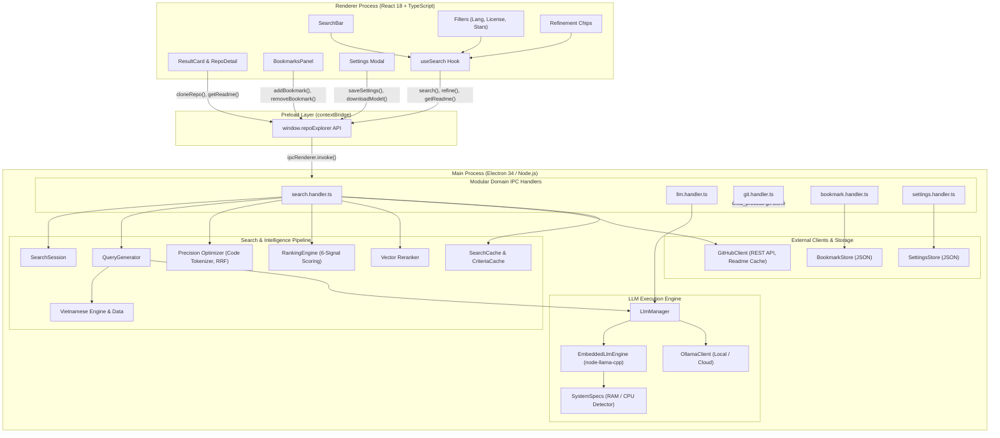

# Repo Explorer

Discover GitHub repositories using natural-language descriptions via an embedded local LLM (zero-config) or custom Ollama.

Type what you need — *"I want a self-hosted CI/CD platform with Docker support"* or *"Công cụ quản lý cơ sở dữ liệu thời gian thực"* — and Repo Explorer uses local LLM intelligence, code-aware tokenization, and a hybrid ranking engine to understand your intent, query GitHub, and rank the best repositories with actionable explanations.

---

## Tech Stack

| Layer | Technology | Description |
|-------|------------|-------------|
| **Desktop Shell** | Electron 34 | Cross-platform desktop runtime for macOS and Windows |
| **Frontend** | React 18 + TypeScript | Component-based UI with custom hooks and responsive design |
| **Markdown & Security** | marked + DOMPurify | Sanitized, high-fidelity README rendering |
| **Build Tooling** | Vite (renderer) + esbuild (main) | Fast HMR in dev and optimized bundle generation |
| **LLM Runtime** | Embedded Local LLM (`node-llama-cpp`, Metal/CPU) + Ollama | Zero-config Qwen2.5 GGUF models (0.5B, 1.5B, 3B) with optional external Ollama |
| **Ranking & Precision** | Precision Optimizer + Vector Reranker | Code-aware tokenization, exact identifier boost, 6-signal scoring & Reciprocal Rank Fusion (RRF) |
| **GitHub Integration** | REST API | Authenticated & unauthenticated queries, rate-limit awareness, bounded concurrency |
| **Testing & IR Benchmark** | Vitest + Golden Evaluation Suite | 671 automated tests (606 unit + 65 integration) with 30-query IR benchmark (P@5, MRR, NDCG) |
| **Load Testing** | Grafana k6 + Node.js harness | Stress testing pipeline measuring p95 and p99 latency under concurrent load |
| **Packaging** | electron-builder | Native NSIS installer (`.exe`) and macOS disk image (`.dmg`) |

---

## Prerequisites

- [Node.js](https://nodejs.org/) 20+
- *(Recommended)* A [GitHub Personal Access Token](https://github.com/settings/tokens) (classic token with `repo` and `read:user` scopes or fine-grained token) for higher API rate limits (5,000 req/hr vs 60 req/hr)
- *(Optional)* [Ollama](https://ollama.com/) if you prefer using external Ollama models instead of the built-in embedded LLM

---

## Quick Start

```bash
# Clone the repository
git clone https://github.com/andoan16/repo-explorer.git
cd repo-explorer

# Install dependencies
npm install

# Start in development mode
npm run dev
```

The app opens automatically:
1. **Zero-Config Local LLM**: The app inspects your system RAM and CPU to suggest the best model tier (Qwen2.5 0.5B, 1.5B, or 3B) and downloads it seamlessly.
2. **Optional External Ollama**: Switch to Ollama in Settings if you run your own local models or use Ollama Cloud.
3. **GitHub Token**: Enter your token in Settings (gear icon, top-right) for uninterrupted searches.

---

## Key Features

- **Tiered Embedded LLM & Auto Hardware Recommendation** — Out-of-the-box local LLM inference via `node-llama-cpp`. System RAM and CPU cores are automatically detected to suggest the optimal model:
  - **Tier 1 (Qwen2.5-0.5B)**: Lightweight (~398 MB), minimal footprint for systems with <8 GB RAM.
  - **Tier 2 (Qwen2.5-1.5B)**: Balanced (~986 MB), optimal for standard 8 GB–16 GB machines.
  - **Tier 3 (Qwen2.5-3B)**: High accuracy (~1.9 GB), recommended for 16 GB+ RAM or Apple Silicon M-series.
- **Search Precision Optimizer & Code-Aware Tokenization** — Splitting of camelCase and PascalCase identifiers (e.g. `pdfCraft` → `pdf`, `craft`), scoped package preservation, and technical keyword preservation (keeps terms like `class`, `server`, `for` from being stripped).
- **Multi-Query Expansion & Hybrid RRF Ranking** — LLM produces 3 query variations with intent and technology filters; results are merged, deduplicated by Jaccard similarity, and ranked via a 6-signal scoring model with min-heap top-K and Reciprocal Rank Fusion.
- **Vietnamese Language Intelligence** — Native Vietnamese query detection, structured dictionary translation, tech-term extraction, synonym expansion, and diacritics-stripped variants for broad recall across GitHub's English index.
- **Smart Fast-Path** — Well-known technical keywords (e.g. `docker`, `react`, `redis`) bypass LLM latency and hit GitHub directly with instant cached responses.
- **Iterative Refinement & Negative-Space Mining** — Inline refinement (e.g. *"prefer Go"*, *"sort by stars"*, *"more DevOps focused"*) re-ranks results in-memory. Result statistics identify underrepresented aspects (negative-space gaps) to propose relevant refinement chips.
- **Interactive Match Breakdown & Lazy Explanations** — Match explanations and READMEs are loaded lazily on demand when inspecting repository cards.
- **Persistent Bookmarks & Local Git Clone** — Bookmark favourite repositories to local JSON storage, copy `git clone` commands, or clone repositories directly into any directory via native system dialogs.
- **Golden Evaluation & Benchmark Suite** — Automated Information Retrieval evaluation across 30 golden test queries measuring Precision@5, Recall@5, Mean Reciprocal Rank (MRR), and NDCG@10.

---

## How It Works

```
1. User Query (English / Vietnamese)
   ├── Fast-path check: Is it an atomic tech name? ──► [Direct GitHub Search]
   └── Vietnamese Detection: Local dictionary translation & synonym expansion
            │
2. LLM Intent & Query Generation (Embedded / Ollama)
   ├── Produces 3 query variations [q1, q2, q3]
   ├── Extracts technologies, intent category, and license requirements
   └── Strips duplicate queries via Jaccard similarity (overlap ≥ 50%)
            │
3. Parallel GitHub Retrieval
   ├── Bounded concurrent requests with rate-limit tracking
   └── Deduplication and merging by repository ID
            │
4. Precision Optimization & Ranking
   ├── README prefetch for top candidates (30-min shared cache)
   ├── Code-aware tokenization & exact identifier boost
   ├── 6-signal relevance scoring:
   │     • Semantic keyword & topic match (30%)
   │     • Stars score (20%)
   │     • Recency of updates (15%)
   │     • README content relevance (15%)
   │     • Language match (10%)
   │     • License compatibility (10%)
   └── Min-heap Top-K selection (O(n log k)) + Reciprocal Rank Fusion
            │
5. Delivery & Refinement Loop
   ├── First 10 results rendered immediately; remaining cached for instant pagination
   └── Background negative-space mining yields async refinement chips
```

---

## Project Architecture

Repo Explorer enforces a strict separation between the **Main Process** (Node.js/Electron) and the **Renderer Process** (React). The renderer never executes filesystem, git, or external HTTP operations directly; all communication occurs through strongly-typed IPC handlers via a secure `contextBridge` preload layer.

### System Architecture Diagram



---

## Component Responsibilities

| Component | Path | Responsibility |
|-----------|------|----------------|
| **IPC Registry** | `src/main/ipc-handlers.ts` | Central dispatch registering domain handlers for clean modularity |
| **Search Handler** | `src/main/handlers/search.handler.ts` | Orchestrates search lifecycle, fast-path, parallel fetch, ranking, pagination, and refinement |
| **LLM Handler** | `src/main/handlers/llm.handler.ts` | Model status reporting, provider switching, specs suggestion, model download streaming |
| **Git Handler** | `src/main/handlers/git.handler.ts` | Local git clone execution and destination folder selection dialogs |
| **Bookmark Handler** | `src/main/handlers/bookmark.handler.ts` | Persistent bookmark creation, removal, and listing |
| **Settings Handler** | `src/main/handlers/settings.handler.ts` | Settings persistence (tokens, provider preferences, theme) |
| **LLM Manager** | `src/main/llm/manager.ts` | Bridges embedded local runtime and external Ollama clients |
| **Embedded LLM Engine** | `src/main/llm/embedded-llm.ts` | `node-llama-cpp` GGUF engine managing model download, context initialization, and text generation |
| **System Specs** | `src/main/llm/system-specs.ts` | System RAM and CPU core inspection for automated model tier recommendation |
| **Precision Optimizer** | `src/main/ranking/precision-optimizer.ts` | Code-aware tokenization (camelCase splitting), technical keyword retention, identifier boosting, and RRF |
| **Vector Reranker** | `src/main/ranking/vector-reranker.ts` | Semantic vector cosine similarity calculation for candidate reranking |
| **Ranking Engine** | `src/main/ranking/engine.ts` | 6-signal weighted relevance scoring with min-heap top-K selection |
| **Vietnamese Engine** | `src/main/search/vietnamese.ts` | Vietnamese detection, translation rules, and query normalization |
| **Vietnamese Data** | `src/main/search/vietnamese-data.ts` | Domain dictionary, technical mapping table, and synonym database |
| **Search Session** | `src/main/search/search-session.ts` | Stateful search session tracking query history, active criteria, pagination cursor, and refinement stack |
| **Search Cache** | `src/main/search/cache.ts` | TTL + LRU caching for GitHub queries (15 min) and LLM criteria (30 min) |

---

## Caching Architecture

| Cache | Location | TTL | Capacity | Eviction Policy |
|-------|----------|-----|----------|-----------------|
| **GitHub Search Results** | `SearchCache` | 15 min | 100 entries | LRU with expired-first |
| **LLM Search Criteria** | `CriteriaCache` | 30 min | 100 entries | LRU with expired-first |
| **Vietnamese Translations** | `VietnameseTranslationCache` | 30 min | 200 entries | LRU with expired-first |
| **README Content** | `GitHubClient.readmeCache` | 30 min | In-memory static | TTL expiration |
| **Bookmarks** | `BookmarkStore` (Disk) | Persistent | Unbounded | User-managed |
| **Settings** | `SettingsStore` (Disk) | Persistent | N/A | Direct write |

---

## Available Scripts

| Command | Description |
|---------|-------------|
| `npm run dev` | Start development mode (Vite HMR + Electron main process restart) |
| `npm run build` | Compile renderer (Vite) and main/preload scripts (esbuild) |
| `npm run test` | Run all Vitest unit tests (606 tests across 22 test suites) |
| `npm run test:watch` | Run unit tests in interactive watch mode |
| `npm run test:integration` | Run integration test suite (65 tests across 7 suites) |
| `npm run test:all` | Run complete test suite (unit + integration, 671 tests) |
| `npm run lint` | Type-check TypeScript codebase without emitting output |
| `npm run package:mac` | Package application as macOS `.dmg` in `release/` |
| `npm run package:win` | Package application as Windows NSIS `.exe` in `release/` |
| `npm run package:all` | Package for both macOS and Windows platforms |

---

## Benchmarks & Quality Assurance

### Information Retrieval Golden Benchmark

Repo Explorer includes a comprehensive Information Retrieval (IR) benchmark suite located in `tests/unit/search-evaluator-benchmark.test.ts` evaluated against `tests/fixtures/golden_queries.json`:

- **30 Golden Queries** covering 5 categories: Developer Tools, Infrastructure & Databases, Frontend & Web, AI & Machine Learning, and Vietnamese queries with negative traps.
- **Quantitative Metrics Measured**:
  - **Precision@5**: Ratio of relevant repositories in the top 5 results.
  - **Recall@5**: Coverage of known golden targets retrieved.
  - **MRR (Mean Reciprocal Rank)**: Position of the first relevant result.
  - **NDCG@10 (Normalized Discounted Cumulative Gain)**: Graded ranking quality.
  - **Negative Trap Suppression**: Verification that irrelevant or deceptive repositories are suppressed from rank #1.

Run the IR benchmark directly:
```bash
npx vitest run tests/unit/search-evaluator-benchmark.test.ts
```

### k6 Performance & Load Testing

A performance test harness measures search pipeline latency under concurrent load:

1. **Start the load-test harness server**:
   ```bash
   npx tsx scripts/load-test-server.ts
   ```
2. **Execute the k6 load test** (simulating 50 concurrent virtual users):
   ```bash
   k6 run scripts/k6/load-test.js
   ```
   *Threshold targets: p95 < 300 ms, p99 < 600 ms, failure rate < 1%.*

---

## Project Structure

```
repo-explorer/
├── .agents/skills/              # Agent skills & development playbooks
├── build/                       # App icon assets (icon.ico, icon.icns)
├── scripts/
│   ├── build-main.mjs           # esbuild configuration for main and preload
│   ├── load-test-server.ts      # Standalone HTTP harness for k6 load tests
│   └── k6/
│       ├── load-test.js         # Grafana k6 performance testing script
│       └── summary.json         # Load testing benchmark metrics
├── src/
│   ├── main/                    # Electron Main Process
│   │   ├── index.ts             # Application lifecycle & browser window creation
│   │   ├── ipc-handlers.ts      # Modular IPC handler dispatcher
│   │   ├── handlers/            # Domain-specific IPC handlers
│   │   │   ├── search.handler.ts    # Search, fast-path, pagination, refinement
│   │   │   ├── llm.handler.ts       # Model status, switching, specs, download
│   │   │   ├── git.handler.ts       # Git clone execution and dialogs
│   │   │   ├── bookmark.handler.ts  # Bookmark store operations
│   │   │   └── settings.handler.ts  # Settings store operations
│   │   ├── llm/                 # LLM Abstraction & Engines
│   │   │   ├── manager.ts       # Unified LLM client provider
│   │   │   ├── embedded-llm.ts  # node-llama-cpp Qwen2.5 GGUF runtime
│   │   │   ├── system-specs.ts  # Hardware RAM and CPU core detector
│   │   │   └── types.ts         # LLM interfaces
│   │   ├── ollama/
│   │   │   └── client.ts        # Ollama HTTP API client (/api/generate, /api/tags)
│   │   ├── github/
│   │   │   └── client.ts        # GitHub REST client with rate limiting & README cache
│   │   ├── search/              # Search & Query Processing Pipeline
│   │   │   ├── query-gen.ts     # Criteria extraction, refinement, suggestions
│   │   │   ├── intent-decomposer.ts # Query intent classification & decomposition
│   │   │   ├── search-session.ts    # Search session state management
│   │   │   ├── cache.ts         # LRU and TTL caches for results & criteria
│   │   │   ├── perf.ts          # Pipeline execution profiling
│   │   │   ├── vietnamese.ts    # Vietnamese translation & normalization
│   │   │   ├── vietnamese-data.ts   # Linguistic dictionaries and synonym data
│   │   │   ├── refinement-parser.ts    # Fast-path deterministic refinement
│   │   │   ├── refinement-validator.ts # Suggestion chip validation & dedup
│   │   │   └── result-stats.ts  # Negative-space analysis & result statistics
│   │   ├── ranking/             # Ranking & Precision Algorithms
│   │   │   ├── engine.ts             # 6-signal relevance scoring with min-heap top-K
│   │   │   ├── precision-optimizer.ts# Code-aware tokenization & RRF fusion
│   │   │   └── vector-reranker.ts    # Semantic vector embedding reranking
│   │   ├── bookmarks/
│   │   │   └── store.ts         # Persistent JSON bookmark store
│   │   ├── settings/
│   │   │   └── store.ts         # Persistent JSON settings store
│   │   └── utils/
│   │       └── concurrency.ts   # Bounded parallel execution helpers
│   ├── preload/
│   │   └── index.ts             # Secure contextBridge API definition
│   ├── renderer/                # React Frontend
│   │   ├── main.tsx             # React DOM entry point
│   │   ├── App.tsx              # Root UI view
│   │   ├── components/          # UI components
│   │   │   ├── SearchBar.tsx        # Natural language input
│   │   │   ├── ResultCard.tsx       # Repository display card
│   │   │   ├── RepoDetail.tsx       # Detail modal with sanitized README
│   │   │   ├── MatchExplanation.tsx  # Visual score breakdown
│   │   │   ├── Filters.tsx          # Star, language, and license filters
│   │   │   ├── Settings.tsx         # Settings modal (LLM, token, theme)
│   │   │   ├── StatusBar.tsx        # Live status indicators
│   │   │   ├── BookmarksPanel.tsx   # Saved repositories manager
│   │   │   ├── BookmarkButton.tsx   # Bookmark toggle
│   │   │   ├── CloneButton.tsx      # Native clone dialog trigger
│   │   │   └── CopyButton.tsx       # Copy git clone command
│   │   ├── hooks/               # Custom React hooks
│   │   │   ├── useSearch.ts     # Search, pagination, and refinement state
│   │   │   ├── useOllama.ts     # LLM status & model synchronization
│   │   │   ├── useSettings.ts   # Settings state management
│   │   │   └── useBookmarks.ts  # Bookmark collection state
│   │   └── styles/
│   │       └── app.css          # Theme styles (light, dark, system)
│   └── shared/
│       ├── types.ts             # Shared data models & IPC contracts
│       └── search-utils.ts      # Shared tokenization and similarity helpers
├── tests/
│   ├── fixtures/
│   │   └── golden_queries.json  # 30-query IR benchmark dataset
│   ├── mocks/                   # Vitest doubles for GitHub & Ollama
│   ├── unit/                    # 606 unit tests across 22 test files
│   └── integration/             # 65 integration tests across 7 test files
├── package.json
├── tsconfig.json
├── vite.config.ts
├── vitest.config.ts
└── vitest.integration.config.ts
```

---

## Building Releases

### macOS (.dmg)
Packaging for macOS requires running on macOS:
```bash
npm run package:mac
```
Output: `release/Repo Explorer-1.0.2.dmg`

### Windows (.exe)
```bash
npm run package:win
```
Output: `release/Repo Explorer-1.0.2-setup.exe`

---

## Error Handling & Resiliency

- **Automatic Model Download Recovery** — Embedded LLM downloads display real-time percentage progress and resume gracefully on transient connection drops.
- **GitHub Rate Limit Protection** — The app monitors remaining rate limits via response headers. If limits are reached, the UI displays clear reset countdowns and prompts for a token.
- **Search Supersession** — In-flight GitHub searches and LLM generation calls are cancelled via `AbortController` whenever the user triggers a new search.
- **Graceful LLM Degradation** — If an LLM call fails or returns malformed output, the system seamlessly falls back to deterministic code-aware keyword extraction.
- **Zero-Recall Recovery for Non-English Queries** — If fast-path keyword search produces zero results for Vietnamese queries, the pipeline automatically falls back to full LLM enrichment to guarantee recall.

---

## License

This project is licensed under the [MIT License](LICENSE).
